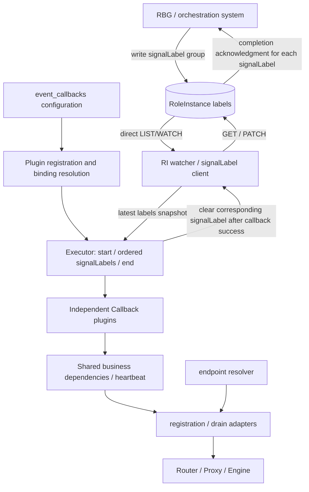
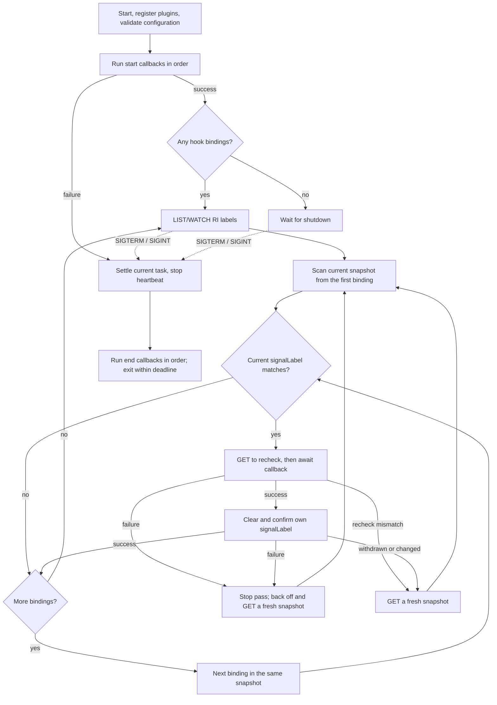

# Proposal 14: Patio as RoleInstance Callback Executor

| Item | Content |
| --- | --- |
| Status | draft |
| Date | Created 2026-11-04; updated 2026-11-11 |
| Author | inference-engine-runtime maintainers |
| Reference | `rbg/keps/527-roleinstance-lifecycle/README.zh-CN.md` |
| Scope | Patio defines callbacks and RBG invokes them through signalLabels; routing onboarding, offboarding, and drain are the initial capabilities |

## Summary

This proposal splits business capabilities into independent asynchronous Callback plugins. Patio configures only ordered callback-name lists for `start` and `end`, plus an ordered `signalLabel -> callback` binding list. RBG signals invocation by writing signalLabels. A unified Executor runs startup, signalLabel-triggered, and shutdown operations. Inputs received by hooks are collectively called signals; signalLabel is currently the only signal implementation.

RoleInstance (RI) is RBG's instance-level resource. A signalLabel is a `key=value` trigger written into RI labels by the orchestration system. Patio directly LISTs/WATCHes the RI, detects signalLabels in configuration order, executes matching callbacks serially, and clears each corresponding signalLabel after success. Each signalLabel binds only one callback; multiple operations use different signalLabels.

```text
Process starts -> register plugins and validate configuration -> run start callbacks
  -> watch RI labels -> match, execute, and clear signalLabels in configuration order
  -> receive SIGTERM / SIGINT -> run end callbacks -> exit
```

## Motivation

### Current behavior

The current `topo_client` behavior is:

```text
Patio starts
  -> derive router / worker / engine endpoints
  -> wait for engine readiness
  -> register
  -> periodically re-register
  -> unregister on SIGTERM / SIGINT
```

This suits "onboard at startup" deployments, but not instance lifecycles controlled by RBG:

1. An instance may already be registered and receiving traffic before RBG allows traffic admission.
2. When RBG starts rebuilding, router / proxy membership may still point to the failed instance.
3. After RBG requests traffic removal, a process restart may register the instance again.
4. SIGTERM is a process event, not an RBG lifecycle signal.
5. Endpoint derivation, the registration protocol, heartbeat, and signal handling are coupled in `topo_client` / `app.py`.

### Goals

1. Use the same Executor for start, signalLabel callbacks, and end. Preserve existing startup behavior through default bindings without adding mode branches.
2. Support independent callback registration and reuse, with users configuring operations and their order directly.
3. Give each operation its own signalLabel. Orchestration writes dependent signalLabels together, and Patio processes them serially in configuration order without bypassing failures.
4. Inside an offboarding callback, stop heartbeat first, wait for the last register to complete, and then unregister. If drain is required, continue waiting for drain.
5. Provide a route-cleanup callback that does not wait for engine drain, for use before recovery or during shutdown.
6. Keep the Executor limited to the signalLabel protocol. Adapters interpret framework differences, and the deployment configures which signal invokes which callback.

### Non-Goals

1. Do not modify the RBG API, RoleInstance spec, or controller state machine.
2. Do not implement Executor election, leases, or authorization.
3. Do not manage Pod finalizers or Pod deletion ordering.
4. Do not define member discovery or action aggregation protocols for multi-Pod RoleInstances.
5. The initial built-in plugins do not implement business-custom drain checks or KVCache save and restore. The business contracts for such plugins are defined separately.
6. Do not implement arbitrary script execution, dynamic Python module imports through YAML, cross-Executor global ordering, or a general dependency DAG.
7. Do not implement Recovery cleanup as an engine-drain barrier; the engine may already be dead.

### User Impact

| User | Impact | Action required |
| --- | --- | --- |
| Kubernetes / RBG operators | Configure signalLabels and operations through `event_callbacks`; failures retain signalLabels and block subsequent bindings | Inject configuration and the RI name, configure RBAC, and guarantee signalLabel grouping, ordering, and unique ownership |
| Application developers | Configuration determines onboarding at startup and offboarding at shutdown, rather than implicit modes | Omit `router_onboard` from start when RBG controls onboarding; confirm long-lived connection and drain requirements |
| SGLang / vLLM integration developers | Protocol adapters must provide confirmable unregister and drain state | Confirm router / proxy APIs and metric semantics |
| Patio maintainers | Add a shared plugin registry, unified Executor, and RI observation layer | Remove legacy startup registration and signal-handling bypasses to avoid duplicate execution |

## Proposal

### User Stories

```text
As a Kubernetes operator,
I want Patio to register an inference worker only after RBG issues the onboarding signal,
so that the instance does not receive traffic before controlled operations are ready.
```

```text
As a Kubernetes operator,
I want Patio to stop heartbeat registration, unregister, and drain requests before update or deletion,
so that RBG can safely replace or delete the RoleInstance.
```

```text
As a Kubernetes operator,
I want Patio to remove stale router membership before RBG Recovery without waiting for engine drain,
so that the router does not continue forwarding traffic to a dead instance while RBG rebuilds it.
```

```text
As an SGLang / vLLM integration developer,
I want registration and drain behavior expressed through explicit adapters,
so that framework differences do not leak into signalLabel scheduling logic.
```

```text
As a plugin developer,
I want independent operations reusable at startup, shutdown, and arbitrary signalLabels,
and I want configuration order across different signalLabels to express removal before saving and restoration before onboarding.
```

## Terminology

| Term | Meaning |
| --- | --- |
| Patio | The runtime process of this inference-engine-runtime project, running as an inference engine sidecar. |
| RoleInstance (RI) | RBG's instance-level resource. One RI represents one inference instance. The first version of this proposal supports only one Pod and one Executor. |
| signal | The trigger input received by a hook; its source is not limited to RI labels. |
| signalLabel | A signal implementation whose value is a `key=value` RI label. Each operation is triggered and acknowledged independently, and the unique Executor deletes the signalLabel after success. |
| Callback plugin | An independent asynchronous operation registered by name. It is unaware of RBG hooks and signalLabels and is not responsible for Kubernetes writeback. |
| `HookBinding` | A binding between one signal source and one callback. The current signal source is signalLabel, and list order defines detection and serial processing order. |
| Executor | The component that runs start / end callbacks, observes the RI, executes matching callbacks in order, retries, and clears signalLabels. |
| registration | The protocol for a worker to join or leave the router or proxy member list. |
| endpoint | The access address for the router / proxy, worker, or engine health. |
| heartbeat | A self-healing mechanism that periodically calls register to restore registration after a router restart. |
| drain | After removal from router / proxy membership, the process of waiting for assigned requests to complete. |
| fail closed | When a result cannot be confirmed, remain blocked, do not clear the signalLabel, and let the controller continue waiting. |
| start / end | Process startup and termination events, not RBG hooks. |

## Architecture Changes

### Current architecture

The current `topo_client` handles all of the following:

- endpoint derivation;
- engine health waiting;
- register / unregister;
- heartbeat re-registration;
- SIGTERM unregistration.

It is neither an RI-level traffic controller nor a lifecycle Executor.

### Target architecture



Start, hook, and end can be configured together and are all converted into the same execution structure. Hook input is a signal; the current implementation supports only signalLabel, and other signal sources can be added later. Without hook bindings, no Kubernetes watcher is created. Without registration-related callbacks, Patio neither starts heartbeat nor modifies router membership. Plugins may share business dependencies, but they do not share an RBG hook interface.

### Directory changes

`api/`, `engine/`, and `metrics/` are unrelated to this proposal and remain unchanged.

Current structure:

```text
patio/
├── app.py
├── envs.py
├── api/
├── engine/
├── metrics/
└── topo/
    ├── client/
    │   ├── base_topo_client.py
    │   ├── sgl_topo_client.py
    │   └── vllm_topo_client.py
    ├── factory.py
    ├── server/
    └── utils.py
```

Target structure:

```text
patio/
├── app.py
├── envs.py
├── api/
├── engine/
├── metrics/
├── lifecycle/              # RI observation and signalLabel writeback
├── runtime/
│   ├── callback_registry.py
│   ├── executor.py
│   ├── callbacks/          # Independent business operations
│   └── heartbeat/
├── registration/
└── endpoint/
```

Migration:

| Current | Target | Change |
| --- | --- | --- |
| `topo/client/*` | `registration/` | Retain only the SGLang / vLLM membership registration protocols |
| Address derivation in `topo/utils.py` | `endpoint/` | Derive router / worker / engine endpoints independently |
| Heartbeat loop in `app.py` | `runtime/heartbeat/` | Encapsulate periodic register with start / stop |
| Startup and signal orchestration in `app.py` | `runtime/executor.py` | Execute configured start, hook, and end uniformly without a registration bypass |
| New | `runtime/callback_registry.py`, `runtime/callbacks/` | Register independent callbacks and share required dependencies during assembly |
| New | `lifecycle/` | Watch the RI directly and provide the latest snapshot and conditional signalLabel cleanup |
| `topo/server/` | Unchanged | Unrelated to the Callback Executor main path |

### Module boundaries

| Module | Responsibility | Not responsible for |
| --- | --- | --- |
| `lifecycle` | Observe the specified RI, read labels, and clear specified signalLabels | RBG hook recognition, business operations, finalizers, election |
| `runtime/executor` | Schedule start / end, match signalLabels in configuration order, execute serially, and retry | RBG hook classification, router protocol |
| `runtime/callbacks` | Independent operations such as onboarding, traffic removal and drain, and route cleanup, including their internal safety ordering | Observing the RI, clearing signalLabels, choosing binding locations |
| `registration` | SGLang / vLLM register / unregister protocols | Deciding when to invoke them |
| `endpoint` | Derive router / worker / engine addresses | Registration protocol |
| `heartbeat` | Start / stop encapsulation for periodic register | Lifecycle decisions |

### Registration semantics

Registration encapsulates only the membership registration protocol:

```text
register
unregister
status
```

SGLang membership identity:

```text
stable logical identity = worker endpoint
worker_id = router-internal handle
```

Patio does not persist `worker_id`. The SGLang router supports listing workers. `status` is implemented from list-worker results. `unregister` lists current members, finds and removes corresponding members by stable worker endpoint, and repeats until the list confirms that the member no longer exists. A missing member is an idempotent success. If member state cannot be confirmed, fail closed and do not clear the signalLabel. If one endpoint maps to multiple logical members, all matching members must be covered.

vLLM membership identity:

```text
register   -> POST /instances/add
unregister -> POST /instances/remove
```

The vLLM proxy already provides `/instances/remove`. In the current Patio implementation, `unregister` is a no-op; this outdated implementation must be completed. If remove fails or its result cannot be confirmed, fail closed and do not clear the signalLabel.

### Endpoint and Heartbeat

Endpoint derivation is independent of the registration protocol and derives the following from environment variables and instance information:

```text
router / proxy endpoint
worker endpoint
engine health endpoint
```

Heartbeat is a self-healing mechanism that periodically calls register, not an offboarding controller:

1. After `start()`, register periodically.
2. After `stop()`, do not schedule new register calls.
3. Start and stop are idempotent.
4. `router_offboard` and `router_cleanup` stop heartbeat internally first.
5. Wait for the last register request to complete before unregistering.
6. `router_onboard` starts heartbeat after registration completes.

`router_cleanup` does not wait for engine drain and can bind to a pre-recovery signalLabel. `router_offboard` continues waiting for drain after unregistration. The callback defines this difference; the Executor does not choose between them based on an RBG hook.

While heartbeat exists, a single failed register can be retried by the next heartbeat. Registration primitives do not need an additional long retry loop.

## RBG Invokes Patio Callbacks Through Labels

### Kubernetes API protocol

When hook bindings exist, Patio directly accesses the following fixed resource:

```text
group:   workloads.x-k8s.io
version: v1alpha2
kind:    RoleInstance
plural:  roleinstances
scope:   Namespaced
```

Both reads and writes target the RI. Patio does not rely on propagating RI labels to the Pod and then reading Downward API files, avoiding repeated observation of old labels caused by propagation delay.

The Executor reads only the keys and values of configured signalLabels. It does not depend on `rbg.workloads.x-k8s.io/role-instance-hook-state` or `rbg.workloads.x-k8s.io/role-instance-lifecycle-state`. Missing labels, unknown values, or changes to these labels neither change callback matching nor preempt tasks.

### Coordination flow

1. When RBG / the orchestration system needs to invoke a Patio callback, it writes a signalLabel. Dependent operations must write their respective signalLabels in the same RI update. signalLabel is the current signal implementation.
2. After completing start callbacks, Patio LISTs the current RI and then WATCHes subsequent changes. Existing signalLabels must also be processed.
3. The Executor scans the same labels snapshot in `hook_bindings` configuration order, not labels dictionary order.
4. When a signalLabel matches, GET the latest RI to recheck it before executing the single bound callback.
5. After callback success, clear its own signalLabel and confirm the cleanup before processing the next entry. On failure, stop subsequent processing for this pass and retry with backoff.
6. RBG advances its workflow based on completion of all signalLabels it is waiting for. Patio does not determine whether the business workflow is complete.

Protocol boundaries:

- The controller does not call Patio's HTTP API, and Patio does not report structured business results to the controller.
- One orchestration action may write multiple signalLabels. Each signalLabel key is assigned to only one Executor.
- A key can have only one value in RI labels at any given time. Operations that reuse the same key with different values must be triggered by orchestration at different times. Dependent signalLabels that must be written in the same update must use different keys.
- A signalLabel that still matches remains pending. Patio does not invalidate it based on RBG lifecycle state.
- Configuration order guarantees ordering only for signalLabels visible together to the same Executor. If a later signalLabel appears alone first, earlier entries are skipped because they do not match, and the later entry executes first. There is no cross-Executor global ordering.

GET rechecks are not distributed locks. Execution semantics depend on unique ownership, orchestration timing, and callback idempotency.

### signalLabel deletion

signalLabel deletion uses an idempotent JSON Merge Patch:

```json
{
  "metadata": {
    "resourceVersion": "<latest-resource-version>",
    "labels": {
      "patio.engine/update-block": null
    }
  }
}
```

A signalLabel may be cleared only after callback success. Before deletion, GET the latest RI and confirm that the key/value still matches. PATCH deletes only that key, does not overwrite other labels, and carries `metadata.resourceVersion` from that GET as an optimistic concurrency precondition. The resourceVersion placeholder in the request must be replaced with the value from that GET. On conflict, GET again instead of blindly resending the old patch.

Confirm signalLabel removal through a successful PATCH response or a subsequent GET. If the PATCH outcome is unknown, do not execute subsequent callbacks. Read again to confirm, and retry if the signalLabel still matches. If the key has been deleted or its value has changed, do not clear the new value. End the current pass and rescan from the latest snapshot. This means only that the old trigger is no longer pending; it does not prove business success.

If business execution succeeded but writeback has not been confirmed, a restart may replay the callback. The resourceVersion check protects label writes, but provides no business transaction, RI UID fencing, or ABA protection for identical key/value pairs.

### Deletion responsibility boundary

The RBG controller and orchestration system guarantee ordering before and after deletion:

1. The RBG controller injects, waits for, and clears the Pod finalizer.
2. The RBG controller does not actively delete the business Pod before the signalLabel is cleared.
3. The deployment system is responsible for Callback Executor / sidecar availability and failure recovery.
4. Patio executes the configured callback bindings. The deployment may bind the pre-deletion traffic-removal signalLabel to `router_offboard`.
5. Patio does not inject, delete, or validate Pod finalizers, and does not guarantee sidecar liveness.

If the Executor is unavailable, the signalLabel remains and the controller continues waiting. RBG defines the behavior of direct external Pod deletion; Patio does not handle it additionally.

## User Configuration

### Event bindings

This proposal adds the optional startup argument `--event-config=/etc/patio/events.yaml` to read YAML configuration. The following binding example onboards at startup, reuses the traffic-removal and drain operation for update / delete signalLabels, onboards for the ready signalLabel, and offboards on exit. The deployment defines signalLabel values.

```yaml
event_callbacks:
  start:
    - router_onboard
  hook:
    # ready hook: onboard
    - signalLabel: "patio.com/router=onboard"
      callback: router_onboard
    # update / delete hook: reuse traffic removal and drain
    - signalLabel: "patio.com/router=offboard"
      callback: router_offboard
  end:
    - router_offboard
```

Rules:

1. `start` and `end` are ordered lists of callback names executed in order. `hook` is an ordered detection list, and each entry contains only `signalLabel` and a single `callback`.
2. Do not use `enabled` or named hook keys. An omitted section is equivalent to an empty list. Explicit `event_callbacks: {}` in a file means no event operations are performed.
3. Callbacks can be reused across locations. Each hook binds only one callback, and multiple operations use different signalLabels.
4. Before startup, reject unknown fields, unknown plugins, non-list fields, malformed entry types, duplicate YAML keys, invalid signalLabels, and duplicate bindings of the exact same signalLabel (same key and value). Bindings with the same key but different values are allowed to reuse one key at different times. Empty lists are valid; explicit null is not equivalent to an empty list.
5. Split each signalLabel at the first `=` and validate Kubernetes label syntax. Reject startup for a missing `=`, an empty key, or an invalid key/value. Empty values are allowed by Kubernetes label rules, and matching must distinguish a missing key from an empty string.
6. Load configuration at startup without hot reload. Reject startup when the file is unreadable, parsing fails, or the format is invalid. Do not silently fall back to startup registration.
7. Compatibility defaults are used only when `--event-config` is absent. Deployments that would previously run a topo client (with `--instance-info`) are converted to `start: [router_onboard]`, `end: [router_cleanup]`, and `hook: []`. Deployments that would not run a topo client receive empty bindings. Both still use the unified Executor, with no separate mode branch.
8. Explicit configuration completely replaces these defaults and does not append default callbacks. The Executor designated by RBG must explicitly mount and specify its configuration. Other instances use empty bindings, with no election or lease.
9. Hook inputs are collectively called signals. The first version implements only signalLabel; other signal sources can be added later without changing callback semantics.

### Runtime parameters and injection

| Argument / variable | Required condition | Meaning |
| --- | --- | --- |
| `--event-config` | Must be explicitly provided for RBG deployments using signalLabels | Event-binding YAML path; a new interface introduced by this proposal |
| `LIFECYCLE_RI_NAME` | Nonempty hook list | Name of the RI to observe |
| `LIFECYCLE_DRAIN_CHECK_INTERVAL` | Optional; default `1s` | Drain polling interval for `router_offboard`; must be positive |
| `LIFECYCLE_DRAIN_STABLE_SAMPLES` | Optional; default `3` | Number of consecutive successful idle samples; must be a positive integer |
| `HEARTBEAT_INTERVAL` | Existing configuration | Heartbeat period |

signalLabel is the first signal implementation, and all signalLabels come from YAML hook bindings. Router, worker, and engine parameters continue to use existing endpoint / `--instance-info` configuration. Dependencies of selected callbacks are validated before startup.

When hooks are nonempty, Patio obtains the namespace from the Pod service account and accesses only the RI named by `LIFECYCLE_RI_NAME` in that namespace. Cross-namespace access and member discovery are not supported. Without hook bindings, Kubernetes credentials are not required.

The RBG Role's `lifecycle.labelsHandler` defines the hook-to-signalLabel mapping. Orchestration must keep it consistent with Patio's callback binding configuration, which can be generated and mounted as a file. Patio consumes only signalLabels and is unaware of hook names. Which Executor runs, when each signalLabel is set, and whether dependent signalLabels are written in the same update are all deployment protocol concerns.

### Signal behavior

Install SIGTERM / SIGINT handling before executing any start callback. After receiving a signal:

1. Stop accepting new hook work, interrupt retry waits, and cooperatively cancel / settle the current callback. Do not let it run concurrently with end callbacks.
2. Stop this process's heartbeat and wait for in-flight register calls to settle, then execute end callbacks in configuration order.
3. End callbacks share one shutdown deadline and run best-effort. After logging a failure, processing may continue to the next entry; exit when the deadline is exhausted. The process shutdown budget provides the deadline, which must be shorter than the Pod's remaining termination grace period and is not restarted for each entry.
4. Signals are not interpreted as any RBG hook, and interrupted signalLabel invocations are not cleared. End callbacks have no signalLabel writeback authority.
5. Finally close watchers, clients, and all local background tasks. Even if an end callback starts background tasks, they cannot extend the process shutdown deadline.

Callbacks must support cancellation and bounded I/O. If the current task cannot settle within the shutdown deadline, do not run end callbacks in parallel; process exit terminates the remaining work. SIGKILL / crashes cannot guarantee end execution. Even if end configures `router_offboard`, it cannot replace the reliable pre-deletion signalLabel workflow.

## Execution Logic and Pseudocode

The following code is pseudocode. It expresses execution order and module collaboration only, not final interfaces or implementation.

### Callback plugin registration

Shared registry module `runtime/callback_registry.py`:

```python
from collections.abc import Awaitable, Callable


EventCallback = Callable[[], Awaitable[None]]
callback_plugins: dict[str, EventCallback] = {}


def register_callback(name: str) -> Callable[[EventCallback], EventCallback]:
    def decorator(callback: EventCallback) -> EventCallback:
        if name in callback_plugins:
            raise ValueError(f"Duplicate Callback plugin registration: {name}")
        callback_plugins[name] = callback
        return callback

    return decorator
```

Independent plugin module `runtime/callbacks/router.py`; only signatures and responsibilities are declared here:

```python
from ..callback_registry import register_callback


@register_callback("router_onboard")
async def router_onboard() -> None:
    # Confirm engine readiness, register routes, and start heartbeat.
    ...


@register_callback("router_offboard")
async def router_offboard() -> None:
    # Stop heartbeat, settle in-flight registration, unregister, and drain.
    ...


@register_callback("router_cleanup")
async def router_cleanup() -> None:
    # Stop heartbeat, settle in-flight registration, and unregister; do not wait for engine drain.
    ...
```

Decorators only save function references during module import and do not execute business operations. At application startup, explicitly import trusted plugin modules before validating configuration. Adding a file alone does not discover it. YAML cannot specify arbitrary module paths or use `eval`. The shared registry does not import business plugins in reverse.

When router clients, heartbeat, engine state, or other state must be shared, register callables with bound dependencies during assembly using `register_callback(name)(bound_callback)`. This is an alternative to decorator registration, and the same name must not be registered twice. The registered callable remains a zero-argument asynchronous operation; there is no requirement to implement a unified multi-event handler differentiated by RBG hook. Dependency assembly must complete before the first invocation.

### Configuration to execution structures

The following input has passed structural, plugin-name, and signalLabel validation described in "User Configuration":

```python
from dataclasses import dataclass

from .callback_registry import EventCallback


@dataclass(frozen=True)
class HookBinding:
    signal_label: str
    callback: EventCallback


def resolve_callbacks(callback_names, callback_plugins) -> list[EventCallback]:
    return [callback_plugins[name] for name in callback_names]


def build_event_bindings(config, callback_plugins):
    events = config.get("event_callbacks", {})
    start_callbacks = resolve_callbacks(events.get("start", []), callback_plugins)
    end_callbacks = resolve_callbacks(events.get("end", []), callback_plugins)
    hook_bindings: list[HookBinding] = []

    for hook_config in events.get("hook", []):
        hook_bindings.append(
            HookBinding(
                signal_label=hook_config["signalLabel"],
                callback=callback_plugins[hook_config["callback"]],
            )
        )

    return start_callbacks, end_callbacks, hook_bindings
```

All three lists preserve configuration order. Registration does not invoke callbacks, create handlers, or enumerate RBG hooks.

The YAML field name is `signalLabel`; the internal Python field uses `signal_label`.

### Executor flow and recovery



The signal entry points in the diagram apply throughout the lifecycle, including while start is waiting. The HTTP API can serve independently. signalLabel callbacks do not execute before start completes.

The following illustrates one ordered pass. The `ri_client` confirmation method follows "signalLabel deletion": return `True` for confirmed cleanup, return `False` when withdrawal / a changed value requires a rescan, and raise an exception on call failure:

```python
async def process_snapshot(snapshot, hook_bindings, ri_client):
    for binding in hook_bindings:
        if not snapshot.matches(binding.signal_label):
            continue

        latest = await ri_client.get()
        if not latest.matches(binding.signal_label):
            return

        await binding.callback()
        if not await ri_client.clear_and_confirm(binding.signal_label):
            return
```

Execution rules:

1. Execute start in order. Failure aborts startup, prevents subsequent start or hook execution, and enters bounded shutdown cleanup. A restart may replay start, so callbacks must be idempotent.
2. Each Executor has only one callback execution lane. The watcher may continue collecting the latest snapshot, but must not start a parallel callback for each event. Events caused by its own PATCH must not cause duplicate concurrent execution either.
3. A pass detects only signalLabels in that pass's snapshot. signalLabels added during scanning are deferred to the next pass, which starts from the beginning of the configuration. Do not splice a later entry from a new snapshot into a pass that has already skipped its prerequisite.
4. On callback or cleanup failure, stop the current pass. GET again with bounded backoff and scan from the beginning of the configuration. A retry timer must wake the Executor even without new watch events. Cleared entries are skipped; a failed entry that still matches is retried, and later entries are not processed by bypassing it.
5. If GET revalidation mismatches or cleanup finds that the signalLabel was withdrawn / changed, end the current pass and rescan using the latest snapshot. Do not clear replacement values or treat withdrawal as business success. External side effects that already occurred cannot be rolled back.
6. Re-LIST/GET after watch disconnection or resourceVersion expiry. If the RI does not exist, do not execute or clear signalLabels based on stale local events.
7. After restart, do not rely on local completion records; read only the RI. An operation whose business execution succeeded but whose signalLabel was not cleared may execute again. A missing signalLabel does not mean a business phase completed and must not automatically start heartbeat.
8. When RBG controls onboarding and start is empty, a process restart does not automatically restore the heartbeat associated with an already-cleared onboarding signalLabel. After confirming that onboarding is allowed, the deployment must trigger the onboarding signalLabel again or define a separate durable recovery protocol. Do not infer recovery from hooks or implicitly start registration compensation.
9. Changes to RBG lifecycle labels do not preempt the current task. Orchestration guarantees signalLabel grouping and timing. Persistent failure blocks subsequent matching entries in the list; this is the cost of a single fail-closed lane.

### Built-in callback contracts

| Callback | Mandatory internal order | Typical signals, not restrictions |
| --- | --- | --- |
| `router_onboard` | Confirm engine ready → register successfully → start heartbeat | start or an onboarding signalLabel |
| `router_offboard` | Stop heartbeat → settle in-flight register → unregister / confirm absence → wait for stable idle | offboarding / pre-deletion signalLabel, or end |
| `router_cleanup` | Stop heartbeat → settle in-flight register → unregister / confirm absence; no engine drain | pre-recovery signalLabel, or end |

Mandatory safety steps cannot be delegated to users for split ordering. For example, `router_offboard` internally guarantees that heartbeat stops before unregistration, and heartbeat remains stopped during failure retries. An unknown unregistration result must raise an error rather than return success. Canceling only the local register coroutine does not prove that the remote request had no effect. The adapter must settle in-flight registration before confirming member removal.

`router_cleanup` does not depend on engine metrics. If the engine is dead or drain is `unknown` / `unsupported`, it succeeds as long as member removal is confirmed. `router_offboard`, which requires drain, continues to fail closed.

These callbacks receive no signalLabel, read no RI lifecycle state, and perform no PATCH themselves. After successful return, the Executor clears the signalLabel. Start / end have no signalLabel completion acknowledgment.

### Cross-feature ordering: routing and KVCache

Assume that `kv_cache_dump` and `kv_cache_restore` are registered in the future. This example demonstrates configuration expressiveness only and is not part of the initial business implementation:

```yaml
event_callbacks:
  hook:
    # Restore KVCache and register the worker with the router
    - signalLabel: "patio.com/kv-cache=restore"
      callback: kv_cache_restore
    - signalLabel: "patio.com/router=onboard"
      callback: router_onboard

    # Unregister the worker from the router and save KVCache
    - signalLabel: "patio.com/router=offboard"
      callback: router_offboard
    - signalLabel: "patio.com/kv-cache=dump"
      callback: kv_cache_dump
```

- Before offboarding: orchestration writes `patio.com/router=offboard` and `patio.com/kv-cache=dump` in the same update. Remove traffic and drain, then clear the former; save KVCache, then clear the latter.
- Before onboarding: write `patio.com/kv-cache=restore` and `patio.com/router=onboard` in the same update. Restore and clear the former, then onboard and clear the latter.
- Each operation has its own signalLabel, and nonmatching entries are skipped. Any operation or cleanup failure prevents subsequent entries. After restart, continue from signalLabels that still exist.
- The same Executor must process the entries, and dependent signalLabels must use different keys and be set in the same update. If a later signalLabel appears alone earlier, the configuration list is not a dependency barrier.

There is no need to change `callback` into a list. The Executor knows only detection order, not which RBG hook a signalLabel belongs to.

### Drain snapshot

The runtime defines only common drain semantics. Each inference framework's adapter interprets what "active / queued / drained" means.

```text
state: idle | draining | unknown | unsupported
active_requests: number | unknown
queued_requests: number | unknown
swapped_requests: number | unknown | not-applicable
source: sglang-metrics | vllm-metrics | engine-api
```

Rules:

1. `unknown` and `unsupported` cannot be treated as idle.
2. If `/metrics` is reachable but a required metric is absent, return `unsupported`. For network failure, timeout, 5xx, parse failure, or NaN, return `unknown`.
3. If a framework cannot provide drain state, `router_offboard` fails closed; `router_cleanup` does not use this check.
4. Determining idle requires all applicable active / queued / swapped values to remain zero for `LIFECYCLE_DRAIN_STABLE_SAMPLES` consecutive samples.
5. Any non-idle sample, including `unknown` / `unsupported`, and any scrape or parse failure resets the stable sample count.
6. The signalLabel path provides no automatic release after timeout. On persistent failure, the signalLabel remains for operator handling. When the same callback is used for end, it is constrained by the shutdown deadline and produces no signalLabel completion acknowledgment.
7. The initial built-in plugins do not support business-custom drain checks. Additional business constraints require a separately defined plugin contract; do not claim that default metrics already cover them.

SGLang initial mapping:

```text
sglang:num_running_reqs -> active_requests
sglang:num_queue_reqs   -> queued_requests
```

Report `idle` when both remain zero for `LIFECYCLE_DRAIN_STABLE_SAMPLES` consecutive samples.

The default vLLM drain snapshot must include three current-state gauges:

```text
vllm:num_requests_running -> active_requests
vllm:num_requests_waiting -> queued_requests
vllm:num_requests_swapped -> swapped_requests
```

High-level idle condition:

```text
active_requests == 0
and queued_requests == 0
and swapped_requests == 0
```

`vllm:num_requests_swapped` represents requests swapped out to CPU but not yet completed. Checking only running / waiting can incorrectly report idle while swapped requests exist. `vllm:num_preemptions_total` is a cumulative counter, not current state, and cannot participate in drain determination.

Classify missing metrics as follows:

1. `/metrics` is reachable but a required metric is absent: return `unsupported`.
2. Network failure, timeout, 5xx, parse failure, or NaN: return `unknown`.
3. Neither `unsupported` nor `unknown` can be treated as idle; retain the signalLabel.

vLLM metrics can cover streaming requests that are still generating, but cannot cover HTTP / SSE / WebSocket long-lived connections that remain open after generation has finished, router / proxy internal buffers, or external business transactions. If the business requires all external connections to close before deletion, it must use a business-custom drain check.

## Responsibility Boundaries and Limitations

### RBG / orchestration system responsibilities

- Designate which Pod / sidecar is the Callback Executor.
- Inject the event configuration file, RI name, and dependencies required by callbacks.
- Manage the RoleInstance lifecycle, hook-to-signalLabel mapping, signalLabel grouping, and write timing; write dependent signalLabels in the same update.
- Manage Pod finalizers and deletion ordering.
- Ensure the Executor is available when the relevant signalLabels must be processed.
- Handle controller / Executor failure recovery.

### Patio responsibilities

- Watch the specified RoleInstance.
- Register independent callbacks, validate configuration, and run start / end.
- Match only signalLabels and execute serially in configuration order.
- Let business callbacks control register / unregister, heartbeat, and drain.
- Clear each callback's own signalLabel after success; on failure, stop subsequent processing and retry.
- Do not infer RBG hooks, business workflow completion, or priority between old and new operations.

### Current limitations

1. RBG must define member discovery and action invocation protocols for multi-Pod RIs. This proposal defines only single-Pod / single-Executor semantics and does not perform member discovery.
2. The initial plugins do not implement business-custom drain checks or KVCache operations. Default metrics cannot cover long-lived connections after generation finishes, router buffers, or external transactions. `router_cleanup` intentionally does not check engine drain.
3. The first version provides neither RI UID fencing nor a durable execution log. For same-name RI recreation, orchestration must ensure the old Executor has settled. Finalizers and idempotency do not provide isolation across object generations.
4. A missing signalLabel cannot restore in-process heartbeat state. After an Executor restart following onboarding, orchestration must explicitly retrigger onboarding.
5. Configuration cannot validate business intent. Binding `router_onboard` to an offboarding signalLabel is structurally valid. Users are responsible for hook-to-signalLabel mapping, ordering, and start / end selection.

## Compatibility

1. Without an event file, generate compatibility default bindings as described in "Event bindings". Preserve startup waiting, registration, heartbeat, and shutdown cleanup for deployments that previously enabled the topo client. The historical vLLM unregister no-op is not a compatibility guarantee.
2. Explicit event configuration is a complete replacement and appends no implicit registration actions. Empty start does not onboard, empty hook does not access Kubernetes, and empty end does not modify membership.
3. Preserve `TOPO_TYPE`, `--instance-info`, endpoint derivation, and business APIs. The new event file determines only when operations are invoked. Old-draft mode ENVs and hook-named signalLabel ENVs must be migrated and cannot be mixed with the new configuration.
4. RBG must correctly implement signalLabel writing, waiting, and completion semantics. Patio does not require a key/value ABI for lifecycle labels. As long as the resource and signalLabel protocol remain unchanged and the callback already exists, RBG can add a hook by adjusting configuration only.
5. SGLang must support listing workers and removal by endpoint; vLLM must support `/instances/remove`. If unregistration cannot be confirmed, both `router_cleanup` and `router_offboard` fail; errors cannot be ignored to allow progress.
6. When vLLM drain is required, running / waiting / swapped gauges must be provided; missing gauges return `unsupported`. This requirement does not apply to `router_cleanup`, which performs no drain.
7. Upgrade Patio and router / proxy before deploying signalLabel bindings. Before rollback, stop new orchestration operations and resolve all unfinished signalLabels. Do not directly switch to startup-onboarding configuration or remove the event file.
8. Adding plugins does not imply support for arbitrary scripts or HTTP check entry points. New metrics and logs are additive capabilities; changes to existing metrics require separate migration guidance.

## Observability

Logs record effective callback order, RI and resourceVersion, signalLabel key, callback name, execution entry point (start / hook / end), retries and failure positions, watch reconnections, registration / drain, and cleanup confirmation results. Do not output service account tokens or other sensitive configuration.

Proposed new metrics:

| Metric | Type | Labels | Meaning |
| --- | --- | --- | --- |
| `patio_lifecycle_event_total` | Counter | `matched` | Number of RI events received and whether any signalLabel matched |
| `patio_lifecycle_action_total` | Counter | `event`, `callback`, `result` | Success, failure, and cancellation counts for start / hook / end callbacks |
| `patio_lifecycle_action_duration_seconds` | Histogram | `event`, `callback`, `step` | Duration of callback execution and signalLabel cleanup |
| `patio_registration_state` | Gauge | `engine`, `protocol` | Current local traffic state: `unregistered`, `registering`, `serving`, `draining`, `recover_cleanup`, `unregistered_confirmed`. `draining` means the registration side is offboarding; see `patio_drain_state` for fine-grained drain state |
| `patio_drain_state` | Gauge | `engine`, `source` | Adapter-reported idle / draining / unknown / unsupported |
| `patio_lifecycle_watch_errors_total` | Counter | `operation`, `reason` | Number of watch / patch / get failures |

Metrics are not classified by RBG hook. Labels do not include RI names, signalLabel keys/values, or resourceVersions. Callback labels use only trusted registered names. Correlate instance-level diagnostics through logs.

Patio's HTTP health / readiness does not automatically fail while a hook is being processed. Patio Ready means only that the process and API are available, not that business registration or drain is complete. External traffic admission is controlled by RBG, the router / proxy, and the deployment.

Troubleshooting:

1. signalLabel retained for a long time: check effective bindings, whether start completed, watch / RBAC, callback failures, and cleanup errors. Also check earlier failed entries in the configuration list.
2. Offboarding failure: check drain for `router_offboard`. For `router_cleanup`, check only heartbeat and router unregistration, without relying on engine metrics.
3. No traffic received: check whether the onboarding signalLabel was issued, whether bindings are correct, engine readiness, registration, and heartbeat. After an Executor restart, heartbeat cannot be automatically restored from signalLabel absence.
4. Controller not advancing: check all signalLabels it waits for, including signalLabels owned by other Executors. Do not treat manual signalLabel deletion as business success.

## Security

1. With hook bindings, use a dedicated ServiceAccount granting `get`, `list`, `watch`, and `patch` on `roleinstances` in the current namespace. LIST/WATCH uses a `metadata.name` field selector. Without hook bindings, these permissions are not required.
2. Native Kubernetes RBAC cannot restrict PATCH to modifying only one label key. Accept this limitation and use a dedicated ServiceAccount, least privilege, and audit logs. Strict field isolation requires admission or a proxy layer.
3. Patio uses the service account token mounted in the Pod and automatically derives the namespace, without introducing long-lived plaintext token configuration. RI names and signalLabels are non-sensitive configuration, but signalLabel keys / values must be validated against Kubernetes label syntax to prevent construction of invalid patches.
4. signalLabel cleanup uses JSON Merge Patch with a resourceVersion precondition, deleting only the configured key and never replacing `metadata.labels` as a whole.
5. Router / proxy and engine endpoints belong to the in-cluster trust boundary. Existing HTTP endpoints add no authentication protocol. Cross-trust-domain deployments should be protected by network policy, mTLS, or a proxy layer rather than expanding this proposal's trust model.
6. Watch, PATCH, and adapter calls must have timeouts and bounded backoff to prevent API failures or slow responses from exhausting threads / coroutines and file descriptors.
7. Load YAML safely and reject duplicate keys. Resolve only callback names from the trusted registry. The registration mechanism is not a sandbox; adding a Python plugin is a trusted code deployment.

## Performance and Scalability

1. Each Callback Executor watches only one specified RoleInstance and uses a field selector or client-side filtering to avoid a namespace-wide informer.
2. The local cache needs only the current RI object and internal traffic state. On resourceVersion expiry or watch reconnection, LIST/GET again without retaining historical objects.
3. Heartbeat retains `HEARTBEAT_INTERVAL`. Periodic registration runs only when a relevant callback starts heartbeat; signalLabel observation itself adds no periodic writes.
4. Drain polling uses an independent interval and minimum sample count. The stable window is implicitly determined by `LIFECYCLE_DRAIN_CHECK_INTERVAL` × `LIFECYCLE_DRAIN_STABLE_SAMPLES`. Request failures count toward backoff and are not treated as idle samples.
5. With hook bindings, each process adds one Kubernetes watch connection and detects N bindings in O(N) per pass. Metric cardinality is bounded by combinations of registered callback / event / result / engine / source values.
6. Drain duration depends primarily on business requests and engine metric refresh and is not a performance SLO that Patio can promise. Benchmarks only confirm that hook and watch overhead is negligible.

## Risks and Mitigations

| Risk | Impact | Detection | Mitigation |
| --- | --- | --- | --- |
| signalLabel configuration differs from orchestration | Operations are not triggered or execute incorrectly | Effective bindings and matched logs | Generate bindings from effective configuration and perform integration validation |
| Callback location or order is misconfigured | Business errors such as saving before traffic removal or onboarding before restoration | Configuration review and ordering tests | Provide deployment examples; callbacks guarantee internal safety ordering |
| Dependent signalLabels are written separately or span Executors | A later operation executes first | RI update logs | Write in the same update to the same Executor; otherwise orchestration must provide additional coordination |
| Callback / PATCH fails persistently | Subsequent matching entries starve | Logs for failed entries and retained signalLabels | Fail closed, back off, and alert; never skip silently |
| Stale events, signalLabel reuse, or same-name RI recreation | Repeated / obsolete business side effects | resourceVersion and callback logs | GET rechecks, conditional PATCH, and idempotency; orchestration constrains reuse and settles the old Executor, without claiming UID fencing |
| Executor restarts after onboarding | Heartbeat is lost | Restart logs and router membership | Orchestration retriggers the signalLabel when onboarding is allowed; do not infer from signalLabel absence |
| Executor is unavailable when a pre-recovery signal arrives | Recovery workflow blocks | Retained signalLabels and process logs | Ensure Executor availability, or do not assign that signalLabel to this sidecar |
| Router list / remove or engine drain metrics are missing | Completion cannot be confirmed | Action / drain metrics | Publish a capability matrix and fail closed when confirmation is impossible |
| Long-lived connections are outside default metric coverage | signalLabel is cleared too early | Business error rate and drain logs | Explicitly evaluate business constraints; define additional plugin contracts separately |
| Onboarding is accidentally configured in start | Restart after traffic removal registers again | Effective configuration logs | RBG deployments explicitly configure empty start and validate deployment arguments |
| Configuration path is wrong or the file is missing | Startup is rejected and the instance is unavailable | Startup failure logs | File failures never fall back to startup registration; validate deployment arguments and alert |

## Drawbacks

1. Deployments with signalLabel bindings add Kubernetes API, RBAC, and configuration dependencies, increasing deployment complexity.
2. signalLabels carry no structured business result or execution ID. The reason for waiting can be located only through logs and metrics.
3. Serial fail-closed processing blocks subsequent matching entries and may wait indefinitely, requiring operator handling.
4. Independent plugins improve reuse, but users are responsible for correct hook-to-signalLabel mapping and cross-feature ordering.
5. The design remains coupled to the RoleInstance resource and signalLabel protocol. Low coupling means only that RBG hooks are not understood, not that the design is unrelated to RBG.

## Alternatives

### Keep only startup registration

This has the smallest change, but cannot participate in RBG-controlled onboarding, update, recovery, and deletion coordination. It cannot clean stale routes before recovery or safely remove and drain traffic.

### RBG controller calls Patio HTTP API directly

Control is direct, but the controller must understand business APIs, network connectivity, and Executor availability, coupling responsibilities. The RBG KEP chooses signalLabel coordination, and this proposal preserves that boundary.

### Keep registration modes and hook dispatch

Mutually exclusive modes and hook enumeration can constrain fixed workflows, but they limit combinations of start / signalLabel / end and require the runtime to change with RBG hooks. This document uses unified bindings and does not retain these branches. Existing behavior is expressed through default callback lists.

### Implement Executor election inside Patio

This could choose an Executor automatically, but introduces leases, authorization, and split-brain problems. This proposal treats which Executor runs a hook as a deployment / orchestration decision, not a runtime decision.

## Test Plan

### Unit tests

1. Registration: imports record references only; duplicate names are rejected; new modules require explicit import; dependency-bound and decorator registration cannot duplicate a name.
2. Configuration: reject unknown fields / plugins, wrong types, duplicate YAML keys, null lists, invalid signalLabels, and duplicate bindings of the exact same signalLabel; allow the same key with different values. Omitted sections and empty lists are valid; distinguish empty label values from missing keys.
3. Defaults: without an event file, generate default bindings based on whether the topo client was enabled. Explicit empty configuration performs no registration. File read failures and old-draft ENVs do not silently fall back. Nonempty hooks require an RI name.
4. Mapping: all three lists preserve order, each `HookBinding` has only one callback, and there is no event-name or handler enumeration.
5. Scheduling: signalLabels visible together execute in configuration order regardless of label dictionary order. Missing entries are skipped. New signalLabels added during execution wait for the next pass. Duplicate events do not execute concurrently.
6. Failure: callback or cleanup failure prevents subsequent entries. Retry occurs even without new watch events. After restart, cleared entries are skipped and unconfirmed entries may be replayed.
7. Hook independence: missing, unknown, or changed lifecycle labels do not affect signalLabel matching. Lifecycle changes do not preempt tasks, and onboarding is not inferred from signalLabel absence.
8. signalLabel cleanup: conditional PATCH only after callback success, preserving other labels. Cover 409, lost responses, GET failure, changed values, deletion, and nonexistent RI.
9. Business callbacks: onboard checks readiness itself; offboard stops heartbeat, settles in-flight register, unregisters, and drains; cleanup never accesses engine drain; retries do not restart heartbeat.
10. Drain: all applicable SGLang running / queue and vLLM running / waiting / swapped gauges must remain zero for the required consecutive samples before idle. Missing metrics are unsupported; network / parse / NaN failures are unknown; any non-idle sample resets the count.
11. Signals: exit is possible while start is waiting. The current callback and end do not run concurrently. End runs in order with a shared deadline and best-effort failures, and does not clear hook signalLabels. Without end, only local resources are settled.

### Integration tests

1. A fake Kubernetes API covers initial LIST, WATCH reconnection, resourceVersion expiry, stale events, conditional PATCH conflicts, and object deletion.
2. Mock router / proxy verifies idempotent registration and unregistration, lost handles, remove failures, and heartbeat. An unreachable engine verifies that cleanup can still succeed.
3. Mock engine metrics verifies complete offboard ordering and retained signalLabels after partial failures.
4. Test callbacks simulate routing / KVCache: set two signalLabels in the same update, verify item-by-item acknowledgment and failure blocking, without implementing KVCache.
5. Verify default-binding compatibility, no registration with explicit empty start, no Kubernetes access with empty hook, and effective end configuration on signals.

### End-to-end tests

Run only when mock integration cannot cover Kubernetes and real engine behavior:

1. Real RBG controller + Patio + SGLang router create / ready / recover / update / delete flows.
2. Real RBG controller + Patio + vLLM proxy `/instances/add` / `/instances/remove` flows.
3. Executor restart, router restart, transient Kubernetes API unavailability, and transient engine metric unavailability.
4. Version-skew matrix: default compatibility bindings, RBG signalLabel configuration, and newly added RBG hooks; verify independence from lifecycle labels.
5. After the onboarding signalLabel is cleared, restart the Executor and have orchestration explicitly retrigger onboarding to restore heartbeat.

### Failure and adversarial tests

1. Inject invalid configuration, missing RBAC, 403 / 409 / 5xx, timeouts, slow routers, and corrupted responses. Verify that signalLabels are not cleared incorrectly and that there is no fallback to startup registration.
2. Race in-flight heartbeat register against offboarding, and verify that old requests cannot register again after unregistration is confirmed.
3. Add two dependent signalLabels in the same update midway through a scan, and verify that the next pass starts from the beginning. A counterexample where the later signalLabel appears alone first must show that the local list cannot provide a dependency barrier.
4. Exercise callback success with lost PATCH responses, restart, signalLabel value changes / withdrawal, and same-name RI recreation. Verify conservative retries and cleanup of only owned keys, and document the boundary of having no UID fencing.
5. Exercise end timeout, SIGKILL, start waiting for a dead engine, and persistent failures blocking subsequent matching entries. Never falsely report business completion.

### Benchmarks

Do not promise a business drain-time SLO. Measure CPU, memory, file descriptor, and network overhead with and without hook bindings, plus scanning and event-coalescing overhead at different binding counts.

## Rollout

1. Complete module separation, plugin registration, and default bindings. Replace legacy startup / signal bypasses and run compatibility regressions.
2. Implement event files, the ordered Executor, RI watcher, and conditional cleanup. Add RBAC, the capability matrix, logs, and metrics.
3. Have orchestration inject explicit start / signalLabel / end configuration. Validate existing RBG hook mappings, multiple-signalLabel ordering, and retriggering after Executor restart at small scale.
4. Expand after confirming there are no residual signalLabels, ordering errors, or unintended registrations.
5. Before rollback, stop new operations and resolve unfinished signalLabels. Replace configuration or roll back the version only after confirming that startup registration may be restored. Do not treat manual signalLabel deletion as success.
6. Migrate explicitly when the signalLabel protocol changes. If RBG only adjusts hook names or hook-to-signalLabel mappings while the signalLabel protocol remains unchanged, no Executor dispatch changes are required.

## Open Questions

The execution rules of this proposal are settled: Patio defines independent callbacks and RBG invokes them through signalLabels; one signalLabel binds one callback; dependent signalLabels are set in the same update and processed by the same Executor in configuration order; lifecycle labels are not read; start / end are explicitly configured; the RI is observed directly; failures are not bypassed; and end is best-effort only.

Registration protocols and default drain parameters remain as defined above. The first version provides no UID fencing, execution generations, cross-Executor dependencies, or durable heartbeat recovery.

Before rollout, the deployment side must verify whether RBG can set dependent signalLabels in the same update, whether the Executor is available during Recovery, how onboarding is retriggered after restart, and how the process shutdown budget aligns with the Pod grace period. Concrete plugin contracts for KVCache and business-custom drain are outside this proposal.

## References

1. RBG KEP-527: `rbg/keps/527-roleinstance-lifecycle/README.zh-CN.md`
2. RBG KEP template: `rbg/keps/NNNN-kep-template/README.md`
3. This repository's proposal template: `proposals/NNNN-template/README.md`
