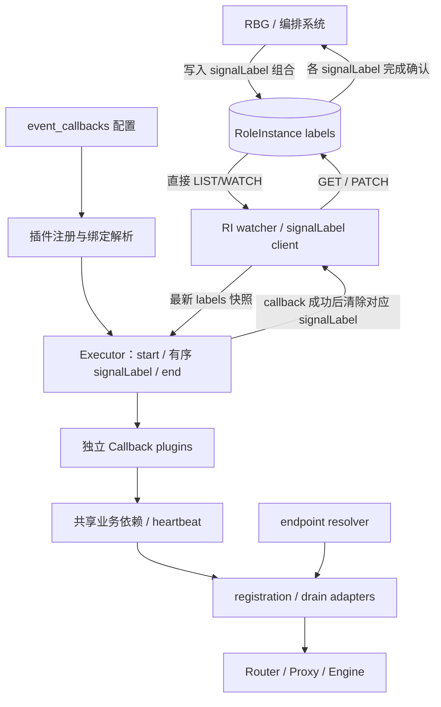
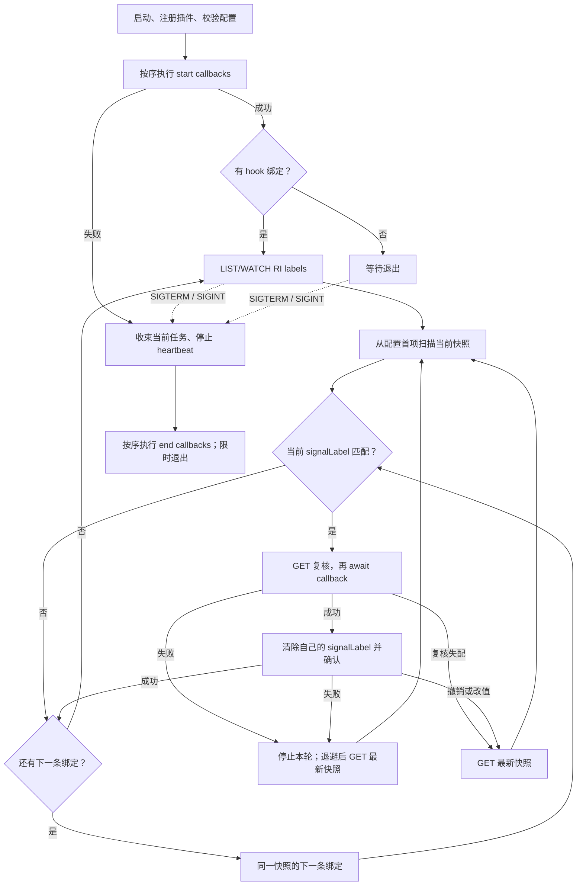

# Proposal 14：Patio 作为 RoleInstance Callback Executor

| 项目 | 内容 |
| --- | --- |
| 状态 | draft |
| 日期 | 2026-11-04 创建，2026-11-11 更新 |
| 作者 | inference-engine-runtime 维护者 |
| 参考 | `rbg/keps/527-roleinstance-lifecycle/README.zh-CN.md` |
| 范围 | Patio 定义 callback，RBG 通过 signalLabel 触发调用；以路由上下线和排空为首批能力 |

## 摘要

本 proposal 将业务能力拆成独立的异步 Callback plugin。Patio 侧只配置 `start`、`end` 的有序 callback 名称列表，以及 `signalLabel -> callback` 绑定列表；RBG 通过写入 signalLabel 发出调用信号。启动、signalLabel 触发和退出操作由统一的 Executor 执行。hook 收到的输入统称 signal；signalLabel 是当前唯一的 signal 实现。

RoleInstance（RI）是 RBG 的实例级资源；signalLabel 是编排系统写入 RI labels 的 `key=value` 触发标记。Patio 直接 LIST/WATCH RI，按配置顺序检测 signalLabel，串行执行匹配的 callback，成功后逐个清除对应 signalLabel。每个 signalLabel 只绑定一个 callback，多个操作使用不同 signalLabel。

```text
程序启动 -> 注册插件并校验配置 -> 执行 start callbacks
  -> 监听 RI labels -> 按配置顺序匹配、执行、清除 signalLabel
  -> 收到 SIGTERM / SIGINT -> 执行 end callbacks -> 退出
```

## 动机

### 现状

当前 `topo_client` 的行为是：

```text
Patio 启动
  -> 推导 router / worker / engine endpoint
  -> 等待 engine ready
  -> register
  -> 周期性 re-register
  -> SIGTERM / SIGINT 时 unregister
```

这适合“启动即上线”的部署，但不适合由 RBG 控制的实例生命周期：

1. RBG 允许接流前，实例可能已经注册并接收流量；
2. RBG 开始重建时，router / proxy 成员可能仍指向失败实例；
3. RBG 要求摘流后，进程重启可能重新注册；
4. SIGTERM 是进程事件，不代表 RBG 生命周期信号；
5. endpoint 推导、注册协议、heartbeat 和信号处理耦合在 `topo_client` / `app.py` 中。

### 目标

1. 用同一个 Executor 执行 start、signalLabel callback 和 end；通过默认绑定兼容存量启动行为，而不增加模式分支。
2. 支持独立 callback 注册和复用，用户直接配置操作及顺序。
3. 多个操作各用独立 signalLabel；编排系统同时写入有依赖的 signalLabel，Patio 按配置顺序串行处理，失败不绕过。
4. 下线 callback 内部先停止 heartbeat，等待最后一次 register 完成，再注销；需要排空时继续等待 drain。
5. 提供不等待 engine 排空的路由清理 callback，供恢复前或退出时使用。
6. Executor 仅理解 signalLabel 协议；框架差异由 adapter 解释，哪个信号调用哪个 callback 由部署方配置。

### 非目标

1. 不修改 RBG API、RoleInstance spec 或 controller 状态机；
2. 不实现 Executor 选举、Lease 或授权；
3. 不管理 Pod finalizer 和 Pod 删除时序；
4. 不定义多 Pod RoleInstance 的成员发现与动作聚合协议；
5. 首批内置 plugin 不实现业务自定义排空检查或 KVCache 保存恢复；此类 plugin 的业务契约另行定义。
6. 不实现任意脚本执行、通过 YAML 动态导入 Python 模块、跨 Executor 全局排序或通用依赖 DAG。
7. 不把 Recovery 清理实现为 engine 排空 barrier；engine 可能已经死亡。

### 用户影响

| 用户 | 影响 | 是否需要行动 |
| --- | --- | --- |
| Kubernetes / RBG 运维人员 | 用 `event_callbacks` 配置 signalLabel 与操作，失败保留 signalLabel 并阻塞后续绑定 | 注入配置和 RI 名称、配置 RBAC，并保证 signalLabel 组合、顺序和唯一所有者 |
| 应用开发者 | 是否启动上线、退出下线均由配置决定，不再由模式隐式决定 | RBG 控制上线时省略 start 中的 `router_onboard`；确认长连接及排空需求 |
| SGLang / vLLM 集成开发者 | 协议 adapter 需要提供可确认的 unregister 和排空状态 | 确认 router / proxy API 与指标语义 |
| Patio 维护者 | 新增公共插件注册表、统一 Executor 与 RI 观察层 | 移除旧启动注册和信号处理旁路，避免重复执行 |

## 提案

### 用户故事

```text
作为一名 Kubernetes 运维人员，
我希望 Patio 只在 RBG 发出上线信号后注册推理 worker，
以便实例在受控操作就绪前不会接收流量。
```

```text
作为一名 Kubernetes 运维人员，
我希望 Patio 在更新或删除前停止 heartbeat 注册、注销并排空请求，
以便 RBG 可以安全替换或删除 RoleInstance。
```

```text
作为一名 Kubernetes 运维人员，
我希望 Patio 在 RBG Recovery 前移除陈旧 router 成员，且不等待 engine 排空，
以便 RBG 重建死亡实例时 router 不继续向它转发流量。
```

```text
作为一名 SGLang / vLLM 集成开发者，
我希望注册和排空行为由显式 adapter 表达，
以便框架差异不会泄漏到 signalLabel 调度逻辑中。
```

```text
作为一名插件开发者，
我希望独立操作能复用于启动、退出和任意 signalLabel，
并通过不同 signalLabel 的配置顺序表达先摘流后保存、先恢复后上线。
```

## 术语

| 术语 | 含义 |
| --- | --- |
| Patio | 本项目 inference-engine-runtime 的运行时进程，作为推理引擎 sidecar。 |
| RoleInstance（RI） | RBG 中的实例级资源，一个 RI 代表一个推理实例；本 proposal 首版只支持单 Pod / 单 Executor。 |
| signal | hook 收到的触发输入；来源不限于 RI label。 |
| signalLabel | signal 的一种实现，值为 RI label 中的 `key=value`；每个操作独立触发、独立确认，成功后由唯一 Executor 删除。 |
| Callback plugin | 以名称注册的独立异步操作，不感知 RBG hook 和 signalLabel，不负责 Kubernetes 写回。 |
| `HookBinding` | 一个 signal 来源与一个 callback 的绑定；当前 signal 来源是 signalLabel，列表顺序就是检测和串行处理顺序。 |
| Executor | 运行 start / end callbacks，观察 RI、按序执行匹配的 callback、重试并清除 signalLabel 的组件。 |
| registration | worker 加入 / 退出 router 或 proxy 成员列表的协议。 |
| endpoint | router / proxy、worker、engine health 的访问地址。 |
| heartbeat | 周期性调用 register 的自愈机制，用于 router 重启后恢复注册。 |
| drain / 排空 | 从 router / proxy 成员中移除后，等待已分配请求完成的过程。 |
| fail closed | 无法确认结果时保持阻塞状态，不清 signalLabel，让 controller 继续等待。 |
| start / end | 进程启动和终止事件，不是 RBG hook。 |

## 架构调整

### 当前架构

当前 `topo_client` 同时承担：

- endpoint 推导；
- engine health 等待；
- register / unregister；
- heartbeat re-register；
- SIGTERM 注销。

它不是 RI 级流量控制器，也不是 lifecycle Executor。

### 目标架构



start、hook 和 end 可以同时配置，全部转换为同一套执行结构。hook 的输入是 signal；当前实现只支持 signalLabel，后续可以扩展其他 signal 来源。没有 hook 绑定时不创建 Kubernetes watcher；没有注册相关 callback 时不启动 heartbeat 或修改 router 成员。插件可以共享业务依赖，但不共享 RBG hook 接口。

### 目录组织变化

`api/`、`engine/`、`metrics/` 与本 proposal 无关，保持不变。

当前结构：

```text
patio/
├── app.py
├── envs.py
├── api/
├── engine/
├── metrics/
└── topo/
    ├── client/
    │   ├── base_topo_client.py
    │   ├── sgl_topo_client.py
    │   └── vllm_topo_client.py
    ├── factory.py
    ├── server/
    └── utils.py
```

目标结构：

```text
patio/
├── app.py
├── envs.py
├── api/
├── engine/
├── metrics/
├── lifecycle/              # RI 观察与 signalLabel 写回
├── runtime/
│   ├── callback_registry.py
│   ├── executor.py
│   ├── callbacks/          # 独立业务操作
│   └── heartbeat/
├── registration/
└── endpoint/
```

迁移关系：

| 当前 | 目标 | 变化 |
| --- | --- | --- |
| `topo/client/*` | `registration/` | 只保留 SGLang / vLLM 成员注册协议 |
| `topo/utils.py` 中的地址推导 | `endpoint/` | 独立推导 router / worker / engine endpoint |
| `app.py` 中的 heartbeat loop | `runtime/heartbeat/` | 封装可 start / stop 的周期 register |
| `app.py` 中的启动和信号编排 | `runtime/executor.py` | 统一执行配置中的 start、hook 和 end，不保留注册旁路 |
| 新增 | `runtime/callback_registry.py`、`runtime/callbacks/` | 注册独立 callback，并在装配时共享所需依赖 |
| 新增 | `lifecycle/` | 直接 watch RI，提供最新快照与 signalLabel 条件清理 |
| `topo/server/` | 保持现状 | 与 Callback Executor 主线无关 |

### 模块边界

| 模块 | 职责 | 不负责 |
| --- | --- | --- |
| `lifecycle` | 观察指定 RI、读取 labels、清理指定 signalLabel | RBG hook 识别、业务操作、finalizer、选举 |
| `runtime/executor` | start / end 调度、按配置顺序匹配 signalLabel、串行执行和重试 | RBG hook 分类、router 协议 |
| `runtime/callbacks` | 上线、摘流排空、路由清理等独立操作及其内部安全顺序 | 观察 RI、清除 signalLabel、决定绑定位置 |
| `registration` | SGLang / vLLM register / unregister 协议 | 决定何时调用 |
| `endpoint` | 推导 router / worker / engine 地址 | 注册协议 |
| `heartbeat` | 周期性 register 的启停封装 | 生命周期决策 |

### Registration 语义

Registration 只封装成员注册协议：

```text
register
unregister
status
```

SGLang 成员身份：

```text
稳定逻辑身份 = worker endpoint
worker_id = router 内部句柄
```

Patio 不把 `worker_id` 作为持久状态。SGLang router 支持 list worker；`status` 由 list worker 结果实现，`unregister` 的语义是：list 当前成员，按稳定 worker endpoint 查找并移除对应成员，直到 list 结果确认成员已不再存在。成员不存在时视为幂等成功；无法确认成员状态时 fail closed，不清 signalLabel。如果一个 endpoint 对应多个逻辑成员，必须覆盖全部匹配成员。

vLLM 成员身份：

```text
register   -> POST /instances/add
unregister -> POST /instances/remove
```

vLLM proxy 已提供 `/instances/remove` 接口。当前 Patio 实现中 `unregister` 是 no-op，属于落后实现，需要补齐。remove 调用失败或无法确认结果时 fail closed，不清 signalLabel。

### Endpoint 与 Heartbeat

Endpoint 推导独立于注册协议，负责根据环境变量和实例信息推导：

```text
router / proxy endpoint
worker endpoint
engine health endpoint
```

Heartbeat 是周期性调用 register 的自愈机制，不是下线控制器：

1. `start()` 后周期性 register；
2. `stop()` 后不再调度新的 register；
3. start / stop 幂等；
4. `router_offboard` 和 `router_cleanup` 内部先 stop heartbeat；
5. 等待最后一次 register 请求完成后再 unregister；
6. `router_onboard` 完成注册后 start heartbeat。

`router_cleanup` 不等待 engine 排空，可绑定到恢复前 signalLabel；`router_offboard` 在注销后继续等待排空。两者的差异由 callback 定义，不由 Executor 根据 RBG hook 选择。

heartbeat 存在时，单次 register 失败可以由下一次 heartbeat 重试；registration 原语不需要额外叠加长时间 retry。

## RBG 通过 label 调用 Patio callback

### Kubernetes API 协议

有 hook 绑定时，Patio 直接访问以下固定资源：

```text
group:   workloads.x-k8s.io
version: v1alpha2
kind:    RoleInstance
plural:  roleinstances
scope:   Namespaced
```

读写对象都是 RI；不经过 RI label 下传到 Pod 再由 Downward API 文件读取，避免下传延迟导致旧 label 被重复观察。

Executor 只读取已配置 signalLabel 的 key/value，不依赖 `rbg.workloads.x-k8s.io/role-instance-hook-state` 或 `rbg.workloads.x-k8s.io/role-instance-lifecycle-state`。这些 label 缺失、取值未知或发生变化，都不改变 callback 的匹配结果，也不触发任务抢占。

### 协作流程

1. RBG / 编排系统需要调用 Patio callback 时写入 signalLabel；有依赖的操作必须在同一次 RI 更新中写入各自的 signalLabel。signalLabel 是 signal 的当前实现。
2. Patio 完成 start callbacks 后，LIST 当前 RI，再 WATCH 后续变化；已有 signalLabel 也必须处理。
3. Executor 按 `hook_bindings` 配置顺序扫描同一个 labels 快照，不按 labels 字典顺序执行。
4. signalLabel 匹配时，先 GET 最新 RI 复核，再执行绑定的单个 callback。
5. callback 成功后清除自己的 signalLabel，确认清除后才处理下一项；失败停止本轮后续处理并退避重试。
6. RBG 依据其等待的全部 signalLabel 的完成情况推进流程，Patio 不判断业务流程是否完成。

协议边界：

- controller 不调用 Patio HTTP API；Patio 不向 controller 上报结构化业务结果。
- 一次编排动作可以写入多个 signalLabel；每个 signalLabel key 只分配给一个 Executor。
- 同一 key 在 RI labels 上同一时刻只能有一个 value；复用同一 key 的不同 value 的操作必须由编排方分时触发，有依赖且需同次写入的 signalLabel 必须使用不同 key。
- signalLabel 仍匹配就代表待处理，Patio 不依据 RBG 生命周期状态使其失效。
- 配置顺序只保证同一 Executor、同批可见 signalLabel 的顺序。后置 signalLabel 若先单独出现，前置项因不匹配被跳过，后置项会先执行；跨 Executor 无全局顺序保证。

GET 复核不是分布式锁。执行语义依赖唯一所有者、编排时序和 callback 幂等。

### signalLabel 删除

删除 signalLabel 使用幂等的 JSON Merge Patch：

```json
{
  "metadata": {
    "resourceVersion": "<latest-resource-version>",
    "labels": {
      "patio.engine/update-block": null
    }
  }
}
```

只有 callback 成功后才允许清除 signalLabel。删除前 GET 最新 RI，确认 key/value 仍匹配；PATCH 只删除该 key，不覆盖其他 labels，并携带本次 GET 得到的 `metadata.resourceVersion` 作为乐观并发前置条件。请求中的 resourceVersion 占位符必须替换为该次 GET 的值；冲突时重新 GET，不能盲目重发旧 patch。

以成功 PATCH 响应或随后 GET 确认 signalLabel 已消除。PATCH 结果未知时，不执行后续 callback；重新读取确认，仍匹配则重试。若 key 已删除或值已变化，不清除新值，结束本轮并从最新快照重新扫描；这只表示旧触发不再待处理，不证明业务成功。

业务成功但写回尚未确认时，重启可能重放 callback。resourceVersion 检查保护标签写入，不提供业务事务、RI UID fencing 或相同 key/value 的 ABA 防护。

### 删除流程权责边界

删除前后的时序由 RBG controller 和编排系统保证：

1. RBG controller 负责 Pod finalizer 的注入、等待和清除；
2. RBG controller 保证 signalLabel 清除前不主动删除业务 Pod；
3. Callback Executor / sidecar 可用性和故障恢复由部署系统负责；
4. Patio 执行配置绑定的 callback；部署方可将删除前摘流 signalLabel 绑定到 `router_offboard`；
5. Patio 不注入、不删除、不校验 Pod finalizer，也不保证 sidecar 存活。

如果 Executor 不可用，signalLabel 保留，controller 继续等待。外部直接删除 Pod 的行为由 RBG 定义，Patio 不额外处理。

## 用户配置

### 事件绑定

本 proposal 新增可选启动参数 `--event-config=/etc/patio/events.yaml`，读取 YAML 配置。以下是绑定结构示例：启动时上线，update / delete signalLabel 复用摘流排空操作，ready signalLabel 上线，退出时执行下线。signalLabel 值由部署方定义。

```yaml
event_callbacks:
  start:
    - router_onboard
  hook:
    # ready hook：上线
    - signalLabel: "patio.com/router=onboard"
      callback: router_onboard
    # update / delete hook：复用摘流排空操作
    - signalLabel: "patio.com/router=offboard"
      callback: router_offboard
  end:
    - router_offboard
```

规则：

1. `start`、`end` 是按序执行的 callback 名称列表；`hook` 是按序检测的绑定列表，每项只含 `signalLabel` 与单个 `callback`。
2. 不使用 `enabled` 或命名 hook 键。省略某部分等于空列表，显式文件中的 `event_callbacks: {}` 表示不执行任何事件操作。
3. callback 可以跨位置复用；每条 hook 只绑定一个 callback，多操作分别使用不同 signalLabel。
4. 启动前拒绝未知字段、未知 plugin、非列表字段、错误条目类型、重复 YAML key、非法 signalLabel，以及完全相同的 signalLabel（同 key 同 value）重复绑定；允许同 key 不同 value 的绑定，用于在不同时刻复用同一 key。空列表合法，显式 null 不等同于空列表。
5. signalLabel 按首个 `=` 拆分并校验 Kubernetes label 语法；缺少 `=`、空 key、非法 key/value 拒绝启动。空 value 按 Kubernetes label 规则允许，匹配时必须区分 key 缺失和空字符串。
6. 配置在启动时加载，不提供热更新。文件不可读、解析失败或格式错误时拒绝启动，不能静默回退到启动注册。
7. 只有未提供 `--event-config` 时才使用兼容默认值：原本会运行 topo client 的部署（提供 `--instance-info`）转换为 `start: [router_onboard]`、`end: [router_cleanup]`、`hook: []`；原本不运行 topo client 的部署转换为空绑定。仍使用统一 Executor，不保留独立模式分支。
8. 显式配置完全替代上述默认值，不追加默认 callback。RBG 指定的 Executor 必须显式挂载并指定配置；其他实例用空绑定，不做选举或 Lease。
9. hook 输入统称 signal；首版只实现 signalLabel，后续可在不改变 callback 语义的前提下扩展其他 signal 来源。

### 运行参数与注入

| 参数 / 变量 | 必填条件 | 含义 |
| --- | --- | --- |
| `--event-config` | 使用 signalLabel 的 RBG 部署必须显式提供 | 事件绑定 YAML 路径，属本 proposal 新增接口 |
| `LIFECYCLE_RI_NAME` | hook 列表非空 | 要观察的 RI 名称 |
| `LIFECYCLE_DRAIN_CHECK_INTERVAL` | 可选，默认 `1s` | `router_offboard` 的排空轮询间隔，必须为正 |
| `LIFECYCLE_DRAIN_STABLE_SAMPLES` | 可选，默认 `3` | 连续成功 idle 样本数，必须为正整数 |
| `HEARTBEAT_INTERVAL` | 沿用现有配置 | heartbeat 周期 |

signalLabel 是 signal 的首版实现，全部来自 YAML hook 绑定。router、worker 和 engine 的参数继续使用现有 endpoint / `--instance-info` 配置，并在启动前校验已选 callback 的依赖。

hook 非空时，Patio 从 Pod service account 获取 namespace，只访问该 namespace 中 `LIFECYCLE_RI_NAME` 指定的 RI；不支持跨 namespace 或成员发现。无 hook 绑定时不要求 Kubernetes 凭据。

RBG Role 的 `lifecycle.labelsHandler` 定义 hook 到 signalLabel 的映射；编排系统需将其与 Patio 的 callback 绑定配置保持一致，配置可以生成并挂载为文件。Patio 只消费 signalLabel，不感知 hook 名称。谁执行、何时设置哪些 signalLabel、依赖 signalLabel 是否同次写入，均属于部署协议。

### 信号行为

在任何 start callback 执行前安装 SIGTERM / SIGINT 处理。收到信号后：

1. 停止接收新的 hook 工作，终止重试等待，并协作取消 / 收束当前 callback；不让它与 end callback 并发执行。
2. 停止本进程 heartbeat 并等待在途 register 收束，再按配置顺序执行 end callbacks。
3. end 共用一个退出期限，best-effort 执行；失败记录后可继续下一项，期限耗尽则退出。退出期限由进程关闭预算提供，必须小于 Pod 剩余 termination grace period，不为每项重新计时。
4. 信号不会被解释成任何 RBG hook，也不会为中断的 signalLabel 调用清除 signalLabel；end callback 不拥有 signalLabel 写回权限。
5. 最终关闭 watcher、clients 和所有本地后台任务；即使 end callback 启动了后台任务，也不能让它延长进程退出期限。

callback 必须支持取消和有界 I/O；若当前任务无法在退出期限内收束，不并行运行 end，由进程退出终止剩余工作。SIGKILL / 崩溃无法保证 end 执行。即使 end 配置 `router_offboard`，也不能替代可靠的删除前 signalLabel 流程。

## 执行逻辑和示意代码

以下代码是伪代码，只表达执行顺序和模块协作，不代表最终接口或实现。

### Callback plugin 注册

公共注册模块 `runtime/callback_registry.py`：

```python
from collections.abc import Awaitable, Callable


EventCallback = Callable[[], Awaitable[None]]
callback_plugins: dict[str, EventCallback] = {}


def register_callback(name: str) -> Callable[[EventCallback], EventCallback]:
    def decorator(callback: EventCallback) -> EventCallback:
        if name in callback_plugins:
            raise ValueError(f"Callback plugin 重复注册：{name}")
        callback_plugins[name] = callback
        return callback

    return decorator
```

独立插件模块 `runtime/callbacks/router.py`，这里只声明签名和职责：

```python
from ..callback_registry import register_callback


@register_callback("router_onboard")
async def router_onboard() -> None:
    # 确认引擎就绪、注册路由、启动 heartbeat。
    ...


@register_callback("router_offboard")
async def router_offboard() -> None:
    # 停止 heartbeat、等待在途注册、注销并排空。
    ...


@register_callback("router_cleanup")
async def router_cleanup() -> None:
    # 停止 heartbeat、等待在途注册、注销；不等待 engine 排空。
    ...
```

装饰器只在模块导入时保存函数引用，不执行业务操作。应用启动时显式导入受信任的插件模块，再校验配置；只增加一个文件不会自动发现，也不允许 YAML 指定任意模块路径或使用 `eval`。公共注册模块不反向导入业务插件。

需要共享 router client、heartbeat、engine 等状态时，在装配阶段用 `register_callback(name)(bound_callback)` 注册已绑定依赖的 callable；这是装饰器注册的替代方式，同名不得重复注册。注册后 callable 仍是无参数异步操作，不要求实现按 RBG hook 区分的统一多事件 handler。首次执行前必须完成依赖装配。

### 配置到执行结构

以下输入已完成“用户配置”一节的结构、插件名和 signalLabel 校验：

```python
from dataclasses import dataclass

from .callback_registry import EventCallback


@dataclass(frozen=True)
class HookBinding:
    signal_label: str
    callback: EventCallback


def resolve_callbacks(callback_names, callback_plugins) -> list[EventCallback]:
    return [callback_plugins[name] for name in callback_names]


def build_event_bindings(config, callback_plugins):
    events = config.get("event_callbacks", {})
    start_callbacks = resolve_callbacks(events.get("start", []), callback_plugins)
    end_callbacks = resolve_callbacks(events.get("end", []), callback_plugins)
    hook_bindings: list[HookBinding] = []

    for hook_config in events.get("hook", []):
        hook_bindings.append(
            HookBinding(
                signal_label=hook_config["signalLabel"],
                callback=callback_plugins[hook_config["callback"]],
            )
        )

    return start_callbacks, end_callbacks, hook_bindings
```

三个列表都保留配置顺序；注册阶段不调用 callback，不创建 handler，也不枚举 RBG hook。

YAML 字段名为 `signalLabel`；Python 内部字段使用 `signal_label`。

### Executor 主流程与恢复



图中信号入口适用于整个生命周期，包括 start 等待期间。HTTP API 可独立服务；start 完成前不执行 signalLabel callback。

单轮有序处理示意；`ri_client` 的确认方法遵循“signalLabel 删除”一节，已确认清理返回 `True`，发现撤销 / 改值需重新扫描时返回 `False`，调用失败抛出异常：

```python
async def process_snapshot(snapshot, hook_bindings, ri_client):
    for binding in hook_bindings:
        if not snapshot.matches(binding.signal_label):
            continue

        latest = await ri_client.get()
        if not latest.matches(binding.signal_label):
            return

        await binding.callback()
        if not await ri_client.clear_and_confirm(binding.signal_label):
            return
```

执行约定：

1. start 按顺序执行；失败终止启动，不执行后续 start 或 hook，并进入有期限的退出清理。重启可能重放 start，callback 必须幂等。
2. 同一 Executor 只有一个 callback 执行通道。watcher 可持续收集最新快照，但不为每个事件启动并行 callback；自身 PATCH 产生的事件也不能重复并发执行。
3. 单轮只检测该轮快照中的 signalLabel。扫描中新增的 signalLabel 留到下一轮，从配置开头检测，不能在已跳过前置项后拼接新快照中的后置项。
4. callback 或清除失败时停止本轮；按有界退避重新 GET，从配置开头扫描。即使没有新 watch 事件，也需由重试定时器唤醒；已清除项跳过，失败项仍匹配则重试，不绕过它处理后续项。
5. GET 复核失配或清除时发现 signalLabel 被撤销 / 改值，结束本轮，使用最新快照重新扫描；不清除替换值，不将撤销视为业务成功。已发生的外部副作用不能回滚。
6. watch 断连 / resourceVersion 过期时重新 LIST/GET；RI 不存在时不执行或清理 signalLabel，不根据本地旧事件操作。
7. 重启后不依赖本地完成记录，只读取 RI。业务成功但 signalLabel 未清除时可重复执行；signalLabel 缺失不代表某个业务阶段完成，也不能据此自动启动 heartbeat。
8. RBG 控制上线且 start 为空时，进程重启不会自动恢复已清除上线 signalLabel 对应的 heartbeat。部署方必须在确认允许上线后重新触发上线 signalLabel，或另行定义持久化恢复协议；不能通过 hook 推断或隐式启动注册补偿。
9. RBG 生命周期 label 的变化不抢占当前任务。signalLabel 组合和时序由编排方保证；长期失败会阻塞列表中后续匹配项，这是单通道 fail-closed 的代价。

### 内置 callback 业务契约

| Callback | 必须保证的内部顺序 | 常见信号（非限制） |
| --- | --- | --- |
| `router_onboard` | 确认 engine ready → register 成功 → 启动 heartbeat | start，或上线 signalLabel |
| `router_offboard` | 停止 heartbeat → 等待在途 register 收束 → unregister / 确认不存在 → 等待稳定 idle | 下线 / 删除前 signalLabel，或 end |
| `router_cleanup` | 停止 heartbeat → 等待在途 register 收束 → unregister / 确认不存在；不做 engine drain | 恢复前 signalLabel，或 end |

必要的安全步骤不能交给用户拆分排序。例如 `router_offboard` 内部保证注销前停止 heartbeat；失败重试期间 heartbeat 保持停止。未知注销结果必须报错，不能作为成功返回。仅取消本地 register 协程不证明远端请求未生效，adapter 必须保证在途注册收束，再确认成员移除。

`router_cleanup` 不依赖 engine 指标；engine 已死或 drain 为 `unknown` / `unsupported` 时，只要成员移除已确认即可成功。需要排空的 `router_offboard` 则继续 fail closed。

这些 callback 不接收 signalLabel，不读取 RI 生命周期状态，不自行 PATCH。成功返回后由 Executor 清理 signalLabel；start / end 没有 signalLabel 完成确认。

### 跨功能顺序：路由与 KVCache

下面假设未来注册了 `kv_cache_dump` 和 `kv_cache_restore`，只展示配置表达能力，不属于首批业务实现：

```yaml
event_callbacks:
  hook:
    # 恢复 KVCache，并将 worker 注册到 router
    - signalLabel: "patio.com/kv-cache=restore"
      callback: kv_cache_restore
    - signalLabel: "patio.com/router=onboard"
      callback: router_onboard

    # 将 worker 从 router 注销，并保存 KVCache
    - signalLabel: "patio.com/router=offboard"
      callback: router_offboard
    - signalLabel: "patio.com/kv-cache=dump"
      callback: kv_cache_dump
```

- 下线前：编排系统同次写入 `patio.com/router=offboard`、`patio.com/kv-cache=dump` 两个 signalLabel；先摘流排空并清除前者，再保存并清除后者。
- 上线前：同次写入 `patio.com/kv-cache=restore`、`patio.com/router=onboard`；先恢复并清除前者，再上线并清除后者。
- 每个操作有自己的 signalLabel，未匹配项跳过；任一操作或清除失败则不执行后续项。重启后从仍存在的 signalLabel 继续。
- 必须由同一 Executor 处理，且有依赖的 signalLabel 使用不同 key 并同次设置；后置 signalLabel 提前单独出现时，配置列表不是依赖屏障。

不需要把 `callback` 改为列表。Executor 只知道检测顺序，不知道 signalLabel 属于哪个 RBG hook。

### 排空快照

runtime 只定义通用排空语义；各推理框架由 adapter 解释“什么是 active / queued / drained”。

```text
state: idle | draining | unknown | unsupported
active_requests: number | unknown
queued_requests: number | unknown
swapped_requests: number | unknown | not-applicable
source: sglang-metrics | vllm-metrics | engine-api
```

规则：

1. `unknown` 和 `unsupported` 不能视为 idle；
2. `/metrics` 可访问但必需指标不存在时返回 `unsupported`；网络失败、超时、5xx、解析失败或 NaN 时返回 `unknown`；
3. 框架无法提供排空状态时，`router_offboard` fail closed，`router_cleanup` 不使用此检查；
4. 判定 idle 需要框架适用的 active / queued / swapped 连续为 0，且达到 `LIFECYCLE_DRAIN_STABLE_SAMPLES`；
5. 任意非 idle 样本（包括 `unknown` / `unsupported`）、抓取或解析失败都重置稳定样本计数；
6. signalLabel 路径不提供超时后自动放行；持续失败时 signalLabel 保留，由运维处理。同一 callback 用于 end 时受退出期限约束，不产生 signalLabel 完成确认。
7. 首批内置 plugin 不支持业务自定义排空检查；额外业务约束需另行定义 plugin 契约，不能声称默认指标已经覆盖。

SGLang 首版映射：

```text
sglang:num_running_reqs -> active_requests
sglang:num_queue_reqs   -> queued_requests
```

两者连续为 0 且达到 `LIFECYCLE_DRAIN_STABLE_SAMPLES` 时报告 `idle`。

默认 vLLM 排空快照必须包含三个当前状态 gauge：

```text
vllm:num_requests_running -> active_requests
vllm:num_requests_waiting -> queued_requests
vllm:num_requests_swapped -> swapped_requests
```

判定 idle 的高层条件：

```text
active_requests == 0
and queued_requests == 0
and swapped_requests == 0
```

`vllm:num_requests_swapped` 表示被换出到 CPU 但尚未完成的请求；只看 running / waiting 可能在 swapped 请求存在时误判为 idle。`vllm:num_preemptions_total` 是累计 counter，不是当前状态，不能参与排空判定。

指标缺失时按以下规则分类：

1. `/metrics` 可访问但必需指标不存在，返回 `unsupported`；
2. 网络失败、超时、5xx、解析失败或 NaN，返回 `unknown`；
3. `unsupported` 和 `unknown` 都不能视为 idle，signalLabel 保留。

vLLM 指标可以覆盖仍在生成的流式请求，但不能覆盖已生成完毕但仍保持的 HTTP / SSE / WebSocket 长连接、router / proxy 内部缓冲或外部业务事务。如果业务要求所有外部连接关闭后才能删除，必须使用业务自定义排空检查。

## 权责边界与限制

### RBG / 编排系统负责

- 指定哪个 Pod / sidecar 是 Callback Executor；
- 注入事件配置文件、RI 名称和 callback 所需依赖；
- 管理 RoleInstance 生命周期、hook 到 signalLabel 的映射、signalLabel 组合及写入时序；有依赖的 signalLabel 同次写入；
- 管理 Pod finalizer 和删除时序；
- 保证需要处理相关 signalLabel 时 Executor 可用；
- 处理 controller / Executor 故障恢复。

### Patio 负责

- watch 指定 RoleInstance；
- 注册独立 callback，校验配置并运行 start / end；
- 只按 signalLabel 匹配，并按配置顺序串行执行；
- 由业务 callback 控制 register / unregister、heartbeat 与排空；
- 成功后逐个清除自己的 signalLabel，失败停止后续处理并重试；
- 不推断 RBG hook、业务流程完成或新旧操作优先级。

### 当前限制

1. 多 Pod RI 的成员发现与动作调用协议需要 RBG 定义。本 proposal 只定义单 Pod / 单 Executor 语义，不做成员发现。
2. 首批 plugin 不做业务自定义排空检查或 KVCache 操作；默认指标不能覆盖生成结束后的长连接、router 缓冲和外部事务。`router_cleanup` 有意不检查 engine 排空。
3. 首版不做 RI UID fencing 或持久化执行日志；同名 RI 重建需由编排系统确保旧 Executor 已收束。finalizer 和幂等性不能提供跨对象代际隔离。
4. signalLabel 缺失不能恢复进程内 heartbeat 状态；上线后的 Executor 重启需要编排方明确重新触发。
5. 配置不能验证业务意图；把 `router_onboard` 绑定到下线 signalLabel 在结构上合法。用户需负责 hook 到 signalLabel 的映射、顺序及 start / end 选择。

## 兼容性

1. 未提供事件文件时，按“事件绑定”一节生成兼容默认绑定；保留原本启用 topo client 时启动等待、注册、heartbeat 和退出清理的行为。不把历史 vLLM unregister no-op 作为兼容保证。
2. 显式事件配置是完整替换，不追加隐式注册动作；空 start 不会上线，空 hook 不访问 Kubernetes，空 end 不修改成员关系。
3. 保留 `TOPO_TYPE`、`--instance-info`、endpoint 推导与业务 API；新增事件文件仅决定何时调用操作。旧草案的模式 ENV 和按 hook 命名的 signalLabel ENV 必须迁移，不能与新配置混用。
4. RBG 需要正确实现 signalLabel 写入、等待和完成语义；Patio 不要求生命周期 label 的 key/value ABI。只要资源和 signalLabel 协议不变且 callback 已存在，RBG 新增 hook 时调整配置即可。
5. SGLang 需支持 list worker 和按 endpoint 移除；vLLM 需支持 `/instances/remove`。无法确认注销时，`router_cleanup` / `router_offboard` 均失败，不能忽略错误放行。
6. 需要 vLLM 排空时必须提供 running / waiting / swapped gauges，缺失返回 `unsupported`；此要求不适用于无排空的 `router_cleanup`。
7. 先升级 Patio 和 router / proxy，再部署 signalLabel 绑定；回滚前停止新编排操作并处理所有未完成 signalLabel，不能直接改成启动上线配置或移除事件文件。
8. 新增 plugin 不等于支持任意脚本或 HTTP 检查入口。新增指标和日志为附加能力，旧指标变更需另行提供迁移说明。

## 可观测性

日志记录有效 callback 顺序、RI 与 resourceVersion、signalLabel key、callback 名称、执行入口（start / hook / end）、重试及失败位置、watch 重连、注册 / 排空和清理确认结果。不得输出 service account token 或其他敏感配置。

建议新增指标：

| 指标 | 类型 | 标签 | 含义 |
| --- | --- | --- | --- |
| `patio_lifecycle_event_total` | Counter | `matched` | 收到的 RI 事件数，以及是否存在匹配 signalLabel |
| `patio_lifecycle_action_total` | Counter | `event`, `callback`, `result` | start / hook / end callback 成功、失败、取消次数 |
| `patio_lifecycle_action_duration_seconds` | Histogram | `event`, `callback`, `step` | callback 执行及 signalLabel 清理耗时 |
| `patio_registration_state` | Gauge | `engine`, `protocol` | 当前本地 traffic state：`unregistered`、`registering`、`serving`、`draining`、`recover_cleanup`、`unregistered_confirmed`；`draining` 表示注册侧正在下线，细粒度排空状态见 `patio_drain_state` |
| `patio_drain_state` | Gauge | `engine`, `source` | adapter 报告的 idle / draining / unknown / unsupported |
| `patio_lifecycle_watch_errors_total` | Counter | `operation`, `reason` | watch / patch / get 失败次数 |

指标不以 RBG hook 分类；标签不包含 RI 名称、signalLabel key/value 或 resourceVersion，callback 只取受信任注册名称。实例级排查通过日志关联。

Patio 的 HTTP health / readiness 不因 hook 处理中而自动失败。Patio Ready 只表示进程和 API 可用，不表示业务注册完成或排空完成；对外流量准入由 RBG、router / proxy 和部署方控制。

排查指引：

1. signalLabel 长期保留：检查有效绑定、start 是否完成、watch / RBAC、callback 失败及清理错误，还需检查配置列表中更早的失败项。
2. 下线失败：`router_offboard` 检查 drain；`router_cleanup` 只检查 heartbeat 和 router 注销，不依赖 engine 指标。
3. 未接流量：检查是否发出了上线 signalLabel、绑定是否正确、engine readiness、注册和 heartbeat；Executor 重启后不能从 signalLabel 缺失自动恢复 heartbeat。
4. controller 未推进：检查其等待的全部 signalLabel，包括其他 Executor 所有的 signalLabel；不要把手动删除 signalLabel 当作业务成功。

## 安全性

1. 有 hook 绑定时使用专用 ServiceAccount，授予当前 namespace 中 `roleinstances` 的 `get`、`list`、`watch`、`patch`；LIST/WATCH 使用 `metadata.name` field selector。无 hook 绑定时不要求这些权限。
2. Kubernetes 原生 RBAC 不能限制 PATCH 只修改某个 label key。需要接受该限制并使用专用 ServiceAccount、最小权限和审计日志；如需严格字段隔离，需要 admission 或代理层。
3. Patio 使用 Pod 挂载的 service account token，并自动推导 namespace，不引入长期明文 token 配置。RI 名称和 signalLabel 是非敏感配置，但 signalLabel key / value 必须按 Kubernetes label 语法校验，防止拼接出非法 patch。
4. signalLabel 清理用携带 resourceVersion 前置条件的 JSON Merge Patch，只删除自己配置的 key，不整体替换 `metadata.labels`。
5. router / proxy 和 engine endpoint 属于集群内信任边界。现有 HTTP endpoint 不新增认证协议；跨信任域部署时应由网络策略、mTLS 或代理层保护，而不是由本 proposal 扩大信任模型。
6. watch、PATCH 和 adapter 调用必须有超时和有界退避，避免 API 故障或慢响应耗尽线程 / 协程和文件描述符。
7. YAML 使用安全加载并拒绝重复键；只解析受信任注册表中的 callback 名称。注册机制不是沙箱，添加 Python plugin 属于受信任代码部署。

## 性能与可扩展性

1. 每个 Callback Executor 只 watch 一个指定 RoleInstance，并使用 field selector 或客户端过滤，避免全 namespace informer。
2. 本地缓存只需要当前 RI 对象和内部 traffic state；resourceVersion 越界或 watch 重连时重新 LIST/GET，不维护历史对象。
3. heartbeat 周期沿用 `HEARTBEAT_INTERVAL`；只有相关 callback 启动 heartbeat 才周期注册，signalLabel 监听本身不增加周期写。
4. drain 轮询使用独立间隔和最小样本数，稳定窗口由 `LIFECYCLE_DRAIN_CHECK_INTERVAL` × `LIFECYCLE_DRAIN_STABLE_SAMPLES` 隐含确定；请求失败计入 backoff，不把失败样本当作 idle。
5. 有 hook 绑定时每个进程增加一个 Kubernetes watch 连接；每轮按 O(N) 检测 N 条绑定。指标基数受已注册 callback / event / result / engine / source 组合约束。
6. 排空耗时主要取决于业务请求和 engine 指标刷新，不属于 Patio 可承诺的性能 SLO；benchmarks 只用于确认 hook 和 watch 自身开销可忽略。

## 风险与缓解

| 风险 | 影响 | 检测 | 缓解 |
| --- | --- | --- | --- |
| signalLabel 配置与编排方不一致 | 操作不触发或错误执行 | 有效绑定、matched 日志 | 从生效配置生成绑定并做集成验证 |
| callback 位置或顺序误配 | 摘流前保存、恢复前上线等业务错误 | 配置审查、顺序测试 | 提供部署示例；内部安全顺序由 callback 保证 |
| 依赖 signalLabel 分次写入或跨 Executor | 后置操作先执行 | RI 更新日志 | 同次写入、同一 Executor；否则需要编排方额外协调 |
| callback / PATCH 长期失败 | 后续匹配项饥饿 | 失败项及 signalLabel 存留日志 | fail closed、退避和告警；不静默跳过 |
| 陈旧事件、signalLabel 重用或同名 RI 重建 | 重复 / 过期业务副作用 | resourceVersion、callback 日志 | GET 复核、条件 PATCH、幂等；编排方约束重用并收束旧 Executor，不宣称 UID fencing |
| 上线后 Executor 重启 | heartbeat 丢失 | 重启日志、router 成员状态 | 允许上线时由编排方重新触发 signalLabel，不从 signalLabel 缺失推断 |
| 恢复前信号到达时 Executor 不可用 | 恢复流程阻塞 | signalLabel 存留和进程日志 | 保证 Executor 可用，否则不要将该 signalLabel 指给此 sidecar |
| 缺少 router list / remove 或 engine 排空指标 | 无法确认完成 | action / drain 指标 | 发布能力矩阵，无法确认时 fail closed |
| 长连接不在默认指标覆盖范围 | 过早清理 signalLabel | 业务错误率、drain 日志 | 显式评估业务约束，额外 plugin 契约另行定义 |
| 误在 start 配置上线 | 摘流后重启重新注册 | 有效配置日志 | RBG 部署显式配置空 start，校验部署参数 |
| 配置路径错误或文件缺失 | 拒绝启动，实例不可用 | 启动失败日志 | 文件失败不回退到启动注册，校验部署参数并告警 |

## 缺点

1. 有 signalLabel 绑定的部署新增 Kubernetes API、RBAC 和配置依赖，部署复杂度上升。
2. signalLabel 没有结构化业务结果或执行编号；只能通过日志和指标定位等待原因。
3. 串行 fail closed 会阻塞后续匹配项，可能无限期等待，需要运维处理。
4. 独立插件提升复用，但用户承担 hook 到 signalLabel 的映射和跨功能排序的正确性责任。
5. 仍耦合 RoleInstance 资源和 signalLabel 协议；低耦合仅指不理解 RBG hook，不表示与 RBG 完全无关。

## 替代方案

### 只保留 startup 注册

优点是改动最小，缺点是无法参与 RBG 控制的上线、更新、恢复、删除协作，无法在恢复前清理陈旧路由，也无法安全摘流和排空。

### RBG controller 直接调用 Patio HTTP API

优点是控制直接，缺点是 controller 必须理解业务 API、网络连通和 Executor 可用性，职责耦合。RBG KEP 选择 signalLabel 协作，本 proposal 保持该边界。

### 保留注册模式与 hook 分发

模式互斥和 hook 枚举能约束固定流程，但限制 start / signalLabel / end 的组合，并要求 runtime 随 RBG hook 变化。本文采用统一绑定，不保留这些分支；存量行为通过默认 callback 列表表达。

### 在 Patio 内实现 Executor 选举

可以自动决定 Executor，但引入 Lease、授权和脑裂问题。本 proposal 认为谁执行 hook 是部署 / 编排决策，不是 runtime 决策。

## 测试计划

### 单元测试

1. 注册：导入只登记引用；重复名称拒绝；新模块需显式导入；绑定依赖与装饰器不能同名重复注册。
2. 配置：未知字段 / plugin、错误类型、重复 YAML key、null 列表、非法 signalLabel、完全相同的 signalLabel 重复绑定拒绝，同 key 不同 value 允许；省略和空列表合法；空 label value 与 key 缺失区分。
3. 默认值：无事件文件时按是否启用 topo client 生成默认绑定；显式空配置不注册；文件读取失败和旧草案 ENV 不静默回退；hook 非空要求 RI 名称。
4. 映射：三类列表保留顺序，每条 `HookBinding` 只有一个 callback，无事件名或 handler 枚举。
5. 调度：同批 signalLabel 按配置顺序执行，与 label 字典顺序无关；缺失项跳过；执行期间新 signalLabel 留到下一轮；重复事件不并发执行。
6. 失败：callback 或清除失败不执行后续项；没有 watch 新事件也会重试；重启后跳过已清除项，允许重放未确认项。
7. hook 无关：生命周期 label 缺失、未知或变化都不影响 signalLabel 匹配；不因生命周期变化抢占，不从 signalLabel 缺失推断上线。
8. signalLabel 清理：仅 callback 成功后条件 PATCH，保护其他 labels；覆盖 409、响应丢失、GET 失败、改值、删除和 RI 不存在。
9. 业务 callback：onboard 自检 ready；offboard 停 heartbeat、等待在途 register、注销、排空；cleanup 不访问 engine drain；重试不重启 heartbeat。
10. drain：SGLang running / queue、vLLM running / waiting / swapped 的全部适用 gauge 连续为零才 idle；缺失为 unsupported，网络 / 解析 / NaN 为 unknown；任何非 idle 重置计数。
11. 信号：start 等待期间可退出；当前 callback 与 end 不并发；end 按序共用期限，失败 best-effort，不清理 hook signalLabel；无 end 时只收束本地资源。

### 集成测试

1. fake Kubernetes API 覆盖初始 LIST、WATCH 重连、resourceVersion 过期、陈旧事件、条件 PATCH 冲突及对象删除。
2. mock router / proxy 验证幂等注册注销、句柄丢失、remove 失败和 heartbeat；用不可达 engine 验证 cleanup 仍可成功。
3. mock engine metrics 验证 offboard 完整顺序和部分失败保留 signalLabel。
4. 用测试 callback 模拟路由 / KVCache：同次设置两个 signalLabel，验证逐项确认与失败阻塞，不要求实现 KVCache。
5. 验证缺省绑定兼容、显式空 start 不注册、空 hook 不访问 Kubernetes，以及信号 end 配置生效。

### 端到端测试

仅在 mock 集成无法覆盖 Kubernetes 与真实 engine 行为时执行：

1. 真实 RBG controller + Patio + SGLang router 的 create / ready / recover / update / delete 流程。
2. 真实 RBG controller + Patio + vLLM proxy 的 `/instances/add` / `/instances/remove` 流程。
3. Executor 重启、router 重启、Kubernetes API 短暂不可用和 engine 指标暂时不可用。
4. 版本偏差矩阵：缺省兼容绑定、RBG signalLabel 配置、新增 RBG hook；验证与生命周期 label 无关。
5. 上线 signalLabel 清除后重启 Executor，由编排系统明确重新触发上线以恢复 heartbeat。

### 失败与对抗测试

1. 注入非法配置、缺失 RBAC、403 / 409 / 5xx、超时、慢 router 和损坏响应，验证不误清 signalLabel 或回退启动注册。
2. 在途 heartbeat register 与下线竞争，验证注销确认后不再被旧请求重新注册。
3. 在扫描中途同次新增两个依赖 signalLabel，验证下一轮从头检测；后置 signalLabel 先单独出现的反例应表明本地列表不能提供依赖屏障。
4. callback 成功但 PATCH 响应丢失、重启、signalLabel 改值 / 撤销、同名 RI 重建；验证保守重试、仅清自己的 key，并记录无 UID fencing 的边界。
5. end 超时、SIGKILL、start 等待 engine 死亡，以及长期失败阻塞后续匹配项；不能伪报业务完成。

### 基准测试

不承诺业务排空时间 SLO。测量有 / 无 hook 绑定时的 CPU、内存、文件描述符、网络开销，以及不同绑定数量下的扫描和事件合并开销。

## 上线计划

1. 完成模块拆分、插件注册和默认绑定，替换旧启动 / 信号旁路，执行兼容性回归。
2. 实现事件文件、有序 Executor、RI watcher 与条件清理，补充 RBAC、能力矩阵、日志和指标。
3. 编排系统注入明确的 start / signalLabel / end 配置，小范围验证现有 RBG hook 映射、多 signalLabel 顺序和 Executor 重启后的重新触发。
4. 确认无遗留 signalLabel、顺序错误和误注册后扩大范围。
5. 回滚前停止新操作并处理未完成 signalLabel；确认允许恢复启动注册后才替换配置或回滚版本，不把手动删除 signalLabel 当作成功。
6. signalLabel 协议变化时显式迁移；RBG 仅调整 hook 名称或 hook 到 signalLabel 的映射而 signalLabel 协议不变时，无需修改 Executor 分发。

## 开放问题

本 proposal 的执行规则已确定：Patio 定义独立 callback，RBG 通过 signalLabel 调用；一 signalLabel 一 callback；同次设置依赖 signalLabel 并由同一 Executor 按配置顺序处理；不读取生命周期 label；start / end 显式配置；直接观察 RI；失败不绕过；end 仅 best-effort。

注册协议与默认排空参数沿用上述定义。首版不提供 UID fencing、执行代际、跨 Executor 依赖或持久化 heartbeat 恢复。

上线前需由部署侧验证：RBG 能否在同次更新中设置依赖 signalLabel、Recovery 期间 Executor 是否可用、上线后重启如何重新触发，以及进程关闭预算如何与 Pod grace period 配合。KVCache 和业务自定义排空的具体 plugin 契约不在本 proposal 内。

## 参考

1. RBG KEP-527：`rbg/keps/527-roleinstance-lifecycle/README.zh-CN.md`
2. RBG KEP 模板：`rbg/keps/NNNN-kep-template/README.md`
3. 本仓库 proposal 模板：`proposals/NNNN-template/README.md`
